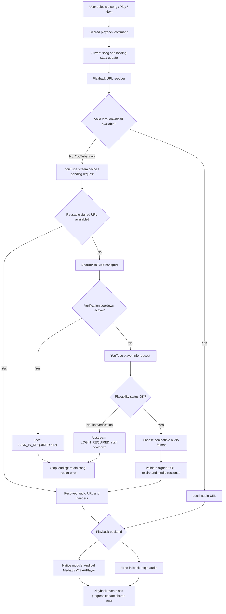

# Mavrixfy: YouTube verification aur playback failure ka detailed analysis

**Reviewed:** 13 October 2026  
**Scope:** Current local code, user-provided logs, aur official playback documentation.  
**Language:** Hinglish, with exact technical names where necessary.

**Current implementation update — 14 October 2026:** At the user's request, the recent Jamendo/FLAC integration was removed: provider resolver, direct Jamendo selections, development test button, iOS FLAC Asset preparation/timeout, provider-specific fallback entries and unused codec metadata. The Jamendo client-ID environment entry and related tests/mocks were removed. Optional JioSaavn and existing YouTube playback remain. Earlier Jamendo/FLAC sections below are historical research, not descriptions of an enabled feature. Verification after removal: 569 regression tests passed, TypeScript typecheck passed, and ESLint passed on changed application files. No physical-device playback test was performed for this removal.

## 1. Sabse important finding

Aapke latest log mein audio source resolve hone se pehle YouTube access reject ho raha hai:

```text
WARN [Player] Upstream requires verification for this track
cause: Error: Audio unavailable. LOGIN_REQUIRED: Sign in to confirm you’re not a bot
reason: sign_in_required
songId: youtube_G8Voqp9rR8E
```

Is request mein app ko usable audio stream return nahi hui. AVPlayer, Media3, buffering UI, progress bar aur StandBy transition is rejection ko solve nahi karte. Playback engine ko successful resolution ke baad hi URL hand over hoti hai.

**Confirmed:** Resolver ne upstream playability rejection propagate kiya.

**Not confirmed:** YouTube ne is device/session/network ko specifically kyun reject kiya. Is warning mein server ka internal detection reason nahi hai. Isse IP ban, permanent account restriction, token expiry, song removal, ya iOS decoder bug prove nahi hota.

## 2. Log ke har field ka meaning

- `WARN [Player]`: App ke playback command ka warning label. Yeh native AVPlayer error label nahi hai.
- `Audio unavailable`: Transport ne stream-resolution failure ko wrap kiya.
- `LOGIN_REQUIRED`: Player-info response ka non-OK playability status, jo resolver ne error mein convert kiya.
- `Sign in to confirm you’re not a bot`: Upstream rejection ka reason text.
- `reason: sign_in_required`: App ka broad classification. Yeh actual rejection aur local verification cooldown dono ko same category mein report kar sakta hai.
- `youtube_G8Voqp9rR8E`: App ka song ID; corresponding video ID `G8Voqp9rR8E` hai. Yeh token ya account ID nahi hai.

**Warning aana aur YouTube ko nayi request jaana ek hi cheez nahi hai.** Neeche actual rejection aur local cooldown ka difference diya hai.

## 3. Complete connection aur playback flow



### Step-by-step responsibilities

1. **Player UI** sends the existing Play/Next command. StandBy uses the same shared playback connection; it is not a separate audio engine.
2. **`audioPlaybackCommands.ts`** retires outgoing output and updates the selected song optimistically. A new title/artwork appearing does not prove that audio started.
3. **`usePlayerCoreState.ts`** coordinates URL resolution and next-song prefetch.
4. **`PlayerPlaybackResolver.ts`** first checks valid downloaded/local audio. A YouTube track then enters its YouTube-specific resolver lane. A YouTube failure does not silently turn into another provider's song.
5. **`YouTubeMusic.ts`** handles reusable stream URLs, deduplicated in-flight requests and per-song invalidation.
6. **`SharedYouTubeTransport.ts`** uses `youtubei.js/react-native` and an Innertube session to obtain stream information. This is the extraction path in the repository, not the official YouTube IFrame player.
7. Only after resolution succeeds does the command load the URL into the playback backend.
8. Native/fallback events update playback state, duration, position and completion handling.

Source references: [Playback commands](src/services/audio/audioPlaybackCommands.ts), [core state](src/services/audio/usePlayerCoreState.ts), [URL resolver](src/services/audio/PlayerPlaybackResolver.ts), [YouTube cache](src/services/youtube/YouTubeMusic.ts), [transport](src/services/youtube/SharedYouTubeTransport.ts).

## 4. Actual upstream rejection versus local cooldown

### A. Actual upstream rejection — your latest example

```text
Audio unavailable. LOGIN_REQUIRED: Sign in to confirm you’re not a bot
```

The resolver reads a non-OK playability status, throws its status/reason, and wraps that failure. The bot-verification text activates a shared **60-second** verification cooldown. Resolution stops at this point: the current loop does not continue switching client profiles after that terminal verification rejection.

### B. Local cooldown message — your earlier examples

```text
SIGN_IN_REQUIRED: Upstream verification required. Try again later.
```

`checkVerificationCooldown()` generates this exact text locally when `Date.now() < verificationBlockedUntil`. For this resolution attempt, the cooldown can prevent the new YouTube request entirely.

Therefore, repeated warnings for different songs during that interval do not establish that every song received a separate YouTube rejection. The cooldown is shared across audio/video resolutions using this transport. A next-song prefetch rejection can also activate it; the visible selected song is not necessarily the request that originally triggered the block.

The 60 seconds are an **app policy**, not a promise that YouTube will allow playback after 60 seconds. The current app does not schedule an automatic retry at the end of this verification cooldown. A later explicit Play attempt can resolve again; another upstream rejection can start a new cooldown.

## 5. Connections involved

There are several distinct connections, not one permanent music socket:

- **Catalog/metadata requests:** titles, artists, thumbnails, playlists and search results. Successful metadata requests do not prove playback access.
- **Player-info requests:** obtain playability status and available stream formats. Your latest warning concerns this access stage.
- **Attestation requests:** request a challenge and mint a proof token when the configured Web client path uses it.
- **Media CDN request:** fetch the signed audio URL, generally a `googlevideo.com` media URL for this provider. This is reached only after usable stream information is obtained.
- **Native decoder/audio session:** AVPlayer or Media3 opens the chosen source and handles output, buffering, focus and lifecycle.

A good Internet connection can still receive an access rejection. Conversely, valid access can still fail later because a URL expires, the media request fails, a file is truncated, or a decoder cannot open it.

The repository's transport uses `expo/fetch` with credentials omitted. Its session creation does not include a Google OAuth login in this path. Mavrixfy/Firebase login should not be assumed to authenticate the user to YouTube.

## 6. Token system: what it does and what it does not prove

The repository already contains a proof-token manager and a lazy WebView host:

- [YouTubePoToken.ts](src/services/youtube/YouTubePoToken.ts)
- [YouTubePoTokenHost.tsx](src/services/youtube/YouTubePoTokenHost.tsx)
- [YouTubePoTokenHtml.ts](src/services/youtube/YouTubePoTokenHtml.ts)
- [YouTubePoTokenHttp.ts](src/services/youtube/YouTubePoTokenHttp.ts)

### Current implemented behavior

- Tokens are held in memory and keyed by video ID within a visitor session.
- Cached tokens are reused only while their recorded lifetime is valid.
- A visitor change resets the manager's session state.
- Concurrent mint requests for the same video are deduplicated.
- Bootstrap has a 10-second command deadline; mint has a 3-second deadline.
- Reply format and expiry are validated locally.
- The cache is bounded to 200 tokens.
- After three counted attestation failures, token minting has a separate **15-minute cooldown**.
- Network-change handling resets token state and connection stream caches.

**There are two different cooldowns:** the transport's 60-second verification cooldown and the token manager's 15-minute repeated-attestation-failure cooldown. They are not interchangeable.

The host is a hidden attestation WebView, not a visible official YouTube video player and not a user sign-in screen. Its shared/third-party cookie options are disabled.

### Important limits

A locally valid token is not proof that YouTube accepted it. A token does not automatically satisfy a sign-in challenge. In the current transport, proof handling is attached to the `MWEB` client path; it is not supplied indiscriminately to `VISIONOS`, `ANDROID_VR`, `TV` and `WEB` requests.

The exact bot-verification rejection exits the current resolution attempt before further profile cycling or HTTP-access session refresh. Therefore, this warning does not establish that the proof host ran, failed, succeeded, or was even reached for this song.

Random strings, repeatedly resetting visitor state, or minting endlessly do not provide a reliable access guarantee. A fresh token is not an “undetectable” identity.

## 7. Native playback versus Expo fallback

### Native module available

The repository's native playback module uses Android Media3 ExoPlayer and iOS AVPlayer APIs. They handle the audio URL and playback lifecycle; they do not perform Google's sign-in verification.

### Expo Go or missing native module

`PlayerContext.tsx` enables the lightweight fallback when running in Expo Go **or when the native TrackPlayer adapter is unavailable**. `NativePlaybackPlayer.ts` uses an optional `MavrixfyPlayback` module outside Expo Go/web.

So a stack trace through `ExpoAvAdapter.ts` proves that the Expo fallback handled that attempt. It does not by itself prove the app is Expo Go: a development/build environment missing the native module can also fall back. The file's legacy name does not mean it uses `expo-av`; its implementation lazily loads `expo-audio`.

This distinction matters when diagnosing a “native IPA only” issue. Record the actual backend/build identity rather than guessing from the UI.

Sources: [PlayerContext](src/contexts/PlayerContext.tsx), [native adapter](src/services/audio/NativePlaybackPlayer.ts), [Expo adapter](src/services/audio/ExpoAvAdapter.ts), [Android engine](modules/mavrixfy-playback/android/src/main/java/com/mavrixfy/playback/PlaybackEngine.kt), [iOS module](modules/mavrixfy-playback/ios/MavrixfyPlaybackModule.swift).

## 8. Why `Cannot Open` is a different problem

```text
ERROR [Player] playSong failed [Error: Cannot Open]
ExpoAvAdapter.ts: reject(new Error(status.error))
```

This is a native audio-load rejection propagated by the Expo listener. The cited JavaScript line reports the error; it does not establish its underlying cause.

Possible causes, not confirmed for the user's failed attempt:

- Remote source became inaccessible or expired after resolution.
- Media request behavior differs between resolver validation and native playback.
- Downloaded/preloaded data is invalid or incomplete.
- Container/codec cannot be decoded by that platform/runtime.
- Native file identification or source loading failed.

The resolver already validates a fresh stream using a bounded open-ended GET, checks its media response type, and cancels the response body. That reduces invalid-source handovers, but does not guarantee the later native request succeeds. Cached stream reuse also does not perform a fresh validation GET on every selection.

The current iOS stream selection restricts audio to AAC-LC (`mp4a.40.2`) because of earlier reported timeline problems. That does not establish AAC-LC as the cause of the current verification warning.

## 9. Preload fixes already applied

[nextTrackPreload.ts](src/services/audio/nextTrackPreload.ts) previously saved every downloaded source with a generic `.audio` extension. A local AVPlayer URL does not carry the original HTTP Content-Type. The code also previously accepted a cached file if it merely existed and had nonzero size, even if it was truncated after download.

Changes now applied:

1. Download to a temporary `.download` path.
2. Validate successful full response, bounded file size, declared length where present, and reject HTML/JSON responses.
3. Derive a recognized media extension from MIME type or a recognized source extension.
4. Rename the complete file to that media extension before publishing it as ready.
5. Skip optional preloading if its container cannot be identified.
6. Store the validated size and reject a changed/truncated cached file at consumption time.
7. If an optional preload is unavailable, the adapter uses its original resolved source.

These are concrete preload corrections. **They do not prove that the particular reported `Cannot Open` was caused by preloading. They do not resolve `LOGIN_REQUIRED`.**

The preload is bounded to 20 MiB and a 25-second download window. Only a completed next-track file is eligible; preloading is not a separate audible player.

## 10. Current error and retry behavior

### Verification errors

- No rapid automatic queue advance.
- No per-failure reset of the global verification cooldown.
- No indefinite token-mint retry.
- Selected song is retained and loading/play intent is cleared with an error.
- A later explicit Play can retry resolution when allowed.

### Transient URL-resolution errors

- Eligible network/timeouts and selected HTTP failures have one bounded retry after 1.2 seconds.
- The first resolution deadline is 27 seconds for YouTube, 12 seconds otherwise; the retry deadline is 15 seconds.
- Authentication/verification and restricted/private/removed cases are excluded from this network retry.
- Selection/account/play-intent checks prevent an obsolete resolution from intentionally restarting a user-paused or replaced selection.

### Loaded playback

The native backend owns native buffering/lifecycle. The Expo fallback has separate bounded startup/stall handling and transient stream-recovery behavior in progress tracking. There is no additional fresh-source decoder retry loop added by the recent verification work.

Startup failures are owned by the pending playback command rather than launching another recovery from the status listener at the same time.

### UI

The extra Play-button spinners were removed at the user's request. Normal playback-buffer information and native buffering remain. A spinner would describe pending work; it would not fix authentication or manufacture playable bytes.

Sources: [commands](src/services/audio/audioPlaybackCommands.ts), [progress handling](src/services/audio/audioProgressTracking.ts), [Expo adapter](src/services/audio/ExpoAvAdapter.ts).

## 11. Network reset: what is actually detected

The token host compares a network key based on network type and connected state. A detected change resets attestation state and clears connection stream caches/cooldown. This protects against reusing a potentially stale connection-bound source.

This detector does not establish that every IP change or Wi-Fi access-point change will be detected. Changing/resetting network state is also not proof that an upstream restriction has disappeared. It should not be called repeatedly as an error bypass.

## 12. Official integration: what changes

The official YouTube IFrame API embeds a visible video player and exposes playback/queue controls and player events. It has a minimum player viewport requirement. It is a different integration from returning raw audio URLs to Media3/AVPlayer. [Official YouTube player documentation](https://developers.google.com/youtube/iframe_api_reference).

Using the official player would require product/UI changes. It is not a drop-in replacement for this native audio-only StandBy experience, nor a guarantee that every video is accessible.

For the existing native music-player design, the durable source architecture is an authorized audio provider, rights-controlled audio, or valid user-imported/local files. This still requires ordinary network/decoder handling; “authorized” does not mean technically failure-free.

Expo's audio APIs expose loaded/buffering state and support downloaded/local playback, but those APIs do not provide YouTube authentication. [Official Expo audio documentation](https://docs.expo.dev/versions/latest/sdk/audio/).

## 13. What cannot be concluded from this warning

The latest warning does **not** prove any of the following:

- The selected song was removed or is unavailable to all YouTube users.
- An iPhone-specific player bug caused access denial.
- Android is immune to the same server-side rejection.
- The device's IP address is permanently blocked.
- A proof token was definitely expired or missing.
- A token was minted and YouTube accepted it.
- Reinstalling, clearing app data or rotating tokens will fix it.
- Every repeated warning represents another network request.
- A prefetch rejection necessarily involved the visible selected song.

Network/session characteristics or request/client compatibility are possible investigation directions, not established explanations for this user's request.

## 14. Diagnosis procedure for the next failure

1. Record build/runtime and actual backend: native module or Expo fallback.
2. Capture the **first** failure with timestamp and song ID, before repeated Play taps.
3. Distinguish `Audio unavailable. LOGIN_REQUIRED...` from the local `SIGN_IN_REQUIRED...Try again later` message.
4. Determine whether the initial rejection came from explicit selection, next-track prefetch or a video resolution.
5. If the problem is verification, do not diagnose it as an AVPlayer load failure.
6. If the problem is `Cannot Open`, capture the newly added `[Audio] Preview load failed` diagnostic.
7. Keep source identity and selection generation consistent when comparing resolver and decoder observations.
8. Test a valid local/imported audio source separately to isolate backend playback from YouTube access.
9. After a failure, verify that Pause/Next does not revive an old selection and that progress belongs to the audible song.

New safe diagnostic fields:

- `songId`: the selected song.
- `source`: `prepared-file`, `remote`, or `local-file`.
- `expired`: true only when known expiry metadata is already past. False can mean metadata is absent; it is not proof of source validity.
- `reason`: shortened native load reason with HTTP URLs redacted.

The diagnostic does not expose signed URLs or headers. It also does not currently contain the native media GET's HTTP status or full iOS NSError domain/underlying error chain. A resolver GET success is not a substitute for those native failure details.

Do not share raw signed URLs, authorization headers, cookies or proof-token values when collecting logs.

## 15. Verification completed and remaining

Completed during the recent code work:

- Full regression suite: 550 tests passed after preload/diagnostic code changes, before the final new diagnostic test was added.
- Focused preload/startup suite including that final diagnostic test: 10 tests passed.
- TypeScript typecheck passed.
- ESLint on changed audio files passed.
- Tests cover recognized container extensions, unknown-container rejection, post-prefetch truncation, failure-source diagnostics, secret redaction and no new decoder retry loop.

Limits:

- Regression tests use controlled fixtures; they do not prove this specific YouTube track plays on a physical device.
- No physical Android device was listed by ADB during the last check.
- No new audible iPhone reproduction or native NSError capture was completed during these fixes.
- Windows cannot perform an Xcode/iOS native compile here.
- No evidence currently establishes the server's exact reason for rejecting this session.

## 16. Recommended actions, in priority order

1. Keep verification rejection, cooldown and decoder failure distinct in diagnostics and user-facing handling.
2. Keep terminal verification errors out of rapid retry/profile-reset/auto-next loops.
3. Validate the latest preload correction on the actual failing runtime.
4. Capture the first real rejection and source/backend details before changing more playback code.
5. Investigate native decoder HTTP/error details only for a source-load failure, not for pre-resolution verification denial.
6. For long-term supported playback, decide between a visible official YouTube player and an authorized native-audio source architecture.

**Final finding:** Your quoted warning is an upstream verification rejection during stream resolution. The app's subsequent local cooldown may explain later repeated warnings. The separate preload defects have been corrected, but the specific `Cannot Open` reproduction and YouTube's internal verification reason remain unconfirmed. No code change currently guarantees access to a server-rejected stream.

## 17. Additional scenario testing: 13 October 2026

### Controlled regression checks

The latest complete suite passed **558 tests, zero failures**. This is the full app regression count, not 558 independent live YouTube songs. TypeScript typecheck and ESLint on the relevant transport/token/preload/Expo adapter files passed.

Seven focused scenarios were added to `scripts/youtube-transport.regression.test.cjs`:

1. Android profile / Low quality: first-client verification rejection.
2. Android profile / Medium quality: first-client verification rejection.
3. Android profile / High quality: first-client verification rejection.
4. iOS profile / Low quality: first-client verification rejection.
5. iOS profile / Medium quality: first-client verification rejection.
6. iOS profile / High quality: first-client verification rejection.
7. A proof is minted and attached to MWEB, but the mocked upstream response still requires verification.

For cases 1–6, the test asserts one VISIONOS player-info attempt, zero token mints, zero media fetches, and a subsequent different-song request blocked by the local cooldown. These cases verify current behavior; passing them does not mean the rejected song plays.

Case 7 deliberately returns HTTP 403 from the initial direct client requests so that the existing MWEB path is reached. It verifies that the proof is attached, a later verification response stops resolution, and the next request does not keep minting or retrying. The upstream responses and proof are controlled fixtures, not live Google attestation.

The full suite also exercises existing scenarios across these independent layers:

- **Transport:** working direct profiles, preferred-client reuse, successful attested MWEB, media HTTP 403, alternate format selection, bounded session refresh, persistent rejection, request cancellation, validation timeout, signed URL/expiry checks, compatible iOS format selection, track-specific restriction versus shared bot-verification cooldown.
- **Token manager:** lazy bootstrap, concurrent same-video deduplication, separate video bindings, cached and expired tokens, visitor changes, late replies, network reset, missing host timeout, repeated-failure cooldown and timer cleanup.
- **Attestation bridge:** allowed interpreter/integrity targets, rejected arbitrary targets, and bundled BgUtils execution using a controlled interpreter fixture.
- **Playback handover:** retained selection on failure, no rapid automatic Next on verification, transient network retry, pause/selection cancellation, progress ownership and startup error ownership.
- **Preload:** complete versus partial download, response/file size mismatch, HTML response rejection, correct media extension, unknown container rejection, truncated/evicted cache, headers matching, queue replacement and active file lease retention.

Detailed automated output: [Full scenario test log](outputs/youtube-complete-scenarios.log).

### Live network probes

The actual repository transport was loaded through the existing Node probe adapter. It used Node/global fetch and platform-selection profiles; it did not run on an Android/iPhone device. The probe has no native WebView attestation host and does not play audible audio or download the complete song.

Initial sandbox attempts returned `fetch failed`; a direct connectivity diagnostic returned `EACCES`. Those results were environmental and are not counted as evidence of a YouTube verification rejection. Read-only probes were then rerun with network access.

**Android selection profile, network-enabled Node run:**

- `G8Voqp9rR8E`: failed after approximately 507 ms with `Audio unavailable. LOGIN_REQUIRED: Sign in to confirm you’re not a bot`.
- `NNpVL7xauj8`, immediately afterward in the same transport instance: failed after approximately 1 ms with the local `SIGN_IN_REQUIRED: Upstream verification required. Try again later.` message.

**iOS selection profile, separate network-enabled Node run:**

- `G8Voqp9rR8E`: failed after approximately 522 ms with the same upstream `LOGIN_REQUIRED` reason.
- `NNpVL7xauj8`, immediately afterward in the same transport instance: returned the local cooldown message in less than 1 ms.

Raw safe summaries: [Android Node probe](outputs/youtube-live-android.json), [iOS Node probe](outputs/youtube-live-ios.json).

The second song's immediate rejection is not evidence of a separate player-info rejection for that video. It confirms the shared cooldown behavior following the first actual rejection. The probes did not force-reset that cooldown between those two songs.

### Findings and limits after these tests

**Now reproduced:** the quoted upstream bot-verification rejection and subsequent local cooldown occur on this workspace's desktop network with the actual transport. Both platform-selection profiles stop before native media loading; changing decoder format cannot affect this observed rejection stage.

**Still not established:** why YouTube rejected the request internally, whether this phone/network receives the same result now, whether a real native WebView proof was minted/accepted, or whether attested MWEB can play this exact song on a physical device.

**Physical-device status:** ADB listed no attached Android phone in this test turn. No physical Android/iOS Play/Pause/Next, complete-song, background or audible output test was completed in this turn.

No production transport/client-order/cooldown changes were made as part of this testing request. Next meaningful verification is a real native-runtime attestation trace that records client, mint outcome and proof-attached status without exposing token values. Mocked token success and a Node probe without a token host cannot replace that check.

## 18. LastWave-Native and open-source comparison

The local `E:\Mavrixfy\LastWave-Native` implementation was inspected alongside upstream projects. This is a source-code comparison, not proof that those apps play the failing video on the user's current network.

### LastWave-Native: observed implementation

- `InnerTubeMusicApi.kt` checks scoped stream caches and deduplicates resolution requests. A total deadline bounds the complete resolver operation.
- Its resolution chain includes a bounded direct-URL fast path, an InnerTubeX stage, then bounded direct-client/NewPipe fallback racing. It does not have the same immediate global-stop policy as Mavrixfy for every first-client login rejection.
- Compatible token-dependent clients receive proof state from the existing BotGuard generator. The generator exposes separate `playerToken` and `sessionToken` fields. Binding and client expectations must be checked before copying their use into a different implementation.
- `BotGuardTokenGenerator.kt` uses an Android WebView, cached minting state, a 10-second cold-start budget, a 3-second warm budget, and a three-failure/15-minute bootstrap cooldown. It is not an automatic CAPTCHA-checkbox or temporary-account implementation.
- `InnerTubeXStreamExtractor.kt` passes visitor/account context through its compatibility adapter. The direct `WEB_REMIX` path can also use the connected YouTube account's authentication context.
- This account context is managed by `YtMusicAuthManager.kt`; it is not created by inventing an account ID. Mavrixfy's present Firebase/Google app login must not be treated as equivalent YouTube request authentication.
- LastWave lets Media3 open validate some candidate URLs instead of blocking all stages on a pre-return media probe. That is a latency/validation tradeoff, not a verification guarantee.

Relevant local files:

- `E:\Mavrixfy\LastWave-Native\app\src\main\java\com\lastwave\app\data\music\InnerTubeMusicApi.kt`
- `E:\Mavrixfy\LastWave-Native\app\src\main\java\com\lastwave\app\data\music\InnerTubeXStreamExtractor.kt`
- `E:\Mavrixfy\LastWave-Native\app\src\main\java\com\lastwave\app\data\music\YouTubeStreamExtractor.kt`
- `E:\Mavrixfy\LastWave-Native\app\src\main\java\com\lastwave\app\data\music\potoken\BotGuardTokenGenerator.kt`
- `E:\Mavrixfy\LastWave-Native\app\src\main\java\com\lastwave\app\data\ytmusic\YtMusicAuthManager.kt`

### Other upstream sources

**NewPipeExtractor:** Its current extractor explicitly classifies bot sign-in denial as `SignInConfirmNotBotException`. It therefore also acknowledges this failure rather than guaranteeing it cannot happen. Its inspected development source documents that the PO-provider setter is currently inactive until supporting-client/SABR integration is available. Adding this dependency alone is not a universal fix. [Inspected extractor source](https://github.com/TeamNewPipe/NewPipeExtractor/blob/dev/extractor/src/main/java/org/schabi/newpipe/extractor/services/youtube/extractors/YoutubeStreamExtractor.java).

**ArchiveTune:** Its playback utility has explicit authentication state, client-compatible proof selection, visitor/account context, separate player/GVS proof checks, and stale-context handling. That is a more developed request-context architecture than appending one generic token everywhere. It remains a reverse-engineered client, not an official access guarantee. [Inspected playback utility](https://github.com/rukamori/ArchiveTune/blob/main/app/src/main/kotlin/moe/rukamori/archivetune/utils/YTPlayerUtils.kt).

**Metrolist:** The repository describes YouTube account login and credits a cipher/PoToken integration. This supports checking integration/context rather than assuming it uses a CAPTCHA autofill. Its README was inspected; its exact playback source path was not retrieved in this review, so no specific code-level fallback behavior is attributed to it. [Repository](https://github.com/MetrolistGroup/Metrolist).

**BgUtils:** Its maintainers describe a reverse-engineered attestation/minter flow and content-bound Web tokens. The minter is reused, and request binding matters. This is proof generation, not a substitute for genuine account authentication. [Maintainer documentation](https://github.com/LuanRT/BgUtils).

**yt-dlp:** Its maintainer guide separates Player, GVS and subtitle token contexts and warns that token applicability depends on client/platform/binding. It explicitly treats enforcement as changing. A Web token should not be assumed usable as an Android/iOS-client token merely because the app runs on that phone platform. [Maintainer PO-token guide](https://github.com/yt-dlp/yt-dlp/wiki/PO-Token-Guide).

### Concrete Mavrixfy gap and recommendation

Mavrixfy can stop at a first direct-client verification response before its existing MWEB proof path is evaluated. This is an observed control-flow difference, not proof that MWEB would succeed. The manager's mere presence does not establish that the failing request was attested.

The next targeted work is to record client identity, proof-host readiness, mint outcome, proof binding/context and attachment status in an actual native runtime without exposing tokens. Then test the existing compatible proof path independently before deciding whether resolver ordering/error classification needs a bounded change.

Do not copy LastWave's entire Android-only racing stack into the React Native app. NewPipe/InnerTubeX integrations are not drop-in iOS equivalents, and their additional architecture conflicts with the requested minimal cross-platform approach unless evidence justifies it. No CAPTCHA automation, invented-account login, token rotation loop or production resolver change was added by this research.


## 19. Full linked-app survey — 14 October 2026

### Review scope and limits

The supplied [app index](https://github.com/chayotic/Open-Source-Music-Streaming-Apps) was fetched live. Its duplicate platform entries reduce to **58 unique GitHub repositories**. All 58 READMEs were retrieved and screened. The separate Monochrome website and its README were also reviewed. Seven shortlisted repositories had their source trees inspected; **18 source/config files** were retrieved, plus two additional Just-Listen files to verify its API base and Android player context. Exact commits and paths are in the local research manifest. This is broad documentation coverage plus targeted source inspection, **not an audit of every file or a working-playback certification for every app**.

Some GitHub metadata requests returned 403 while README retrieval succeeded. Those entries have incomplete license/maintenance metadata. No repository installation scripts were executed; no app was built or tested on a phone in this survey.

### Useful findings for Mavrixfy

**1. Audius is a concrete alternative streaming API.** Just-Listen's current source sets its base URL to https://api.audius.co, consistent with its Audius-backed README. Audius documents catalog search and track streaming endpoints. A small provider adapter could hand a resolved source to our existing Media3/AVPlayer connection; replacing the playback engines is unnecessary. Expo fallback can consume an ordinary compatible audio source, but actual runtime testing remains required. [Audius API](https://docs.audius.co/api/), [Just-Listen API client](https://github.com/RLD-JL/Just-Listen/blob/a29ff29fe2a4222c1d3e6801eead9bbcb99a4bb6/shared/src/commonMain/kotlin/com/rld/justlisten/datalayer/webservices/ApiClient.kt).

Live read-only probe at **2026-10-14T05:45:21.100Z**: trending metadata returned **200**. Ungated track **GEG9ZWx**, “Rowsfred - CLAWN (Original Mix) [Eclipse Records]”, reported **210 seconds**. A request for bytes 0–1023 returned **206, audio/mpeg, bytes 0-1023/8405906**; response body was cancelled. This verifies an accessible MP3 response for one public track, not full-song decoding, all tracks, guaranteed uptime, or phone output. The README's 320 kbps statement was not independently established for every track.

Audius has its own catalog: it is **not a guaranteed substitute for the same Bollywood/YouTube selections**. Gated content has additional access requirements. Before product deployment, review Audius's API terms and music-player eligibility; public HTTP access alone does not establish every intended redistribution/use right. [Track APIs](https://docs.audius.co/sdk/tracks/), [Audius Open Music License](https://audius.org/open-music-license.pdf).

**2. OpenSubsonic/Jellyfin is useful for an owned or authorized library.** Supersonic separates providers and implements source URL resolution. Its Subsonic implementation sends codec/bitrate options or raw format. The official stream endpoint supports raw output without transcoding. This can preserve original quality when the library and device support it; it does not supply a free commercial catalog. [Subsonic implementation](https://github.com/supersonic-app/supersonic/blob/f28980f8d79d0c6b43d43b512c99d84a66632e47/backend/mediaprovider/subsonic/subsonicmediaprovider.go), [Jellyfin implementation](https://github.com/supersonic-app/supersonic/blob/f28980f8d79d0c6b43d43b512c99d84a66632e47/backend/mediaprovider/jellyfin/jellyfinmediaprovider.go), [OpenSubsonic stream documentation](https://opensubsonic.netlify.app/docs/endpoints/stream/).

**3. Spotube/Bloomee offer useful provider patterns.** Spotube models track matching separately from stream URL, container, codec and quality information. Bloomee resolves through the owning plugin and keeps local files in their own lane. These are good concepts for our existing resolver, not a reason to import an entire Flutter/Rust/plugin runtime. Plugin source availability remains a dependency. [Spotube source model](https://github.com/team-spotube/spotube/blob/69a310c78f5ceaf4eab7dfee98f187d38211c9ba/lib/models/metadata/audio_source.dart), [Bloomee resolver](https://github.com/HemantKArya/BloomeeTunes/blob/6fdb37d7d53c91c37fdd293c31a7a139ebae319e/lib/services/player/media_resolver_service.dart).

Bloomee's replacement service scores alternate candidates and permits explicit application to playlists. Its threshold is an app heuristic, not proof that a candidate is the identical recording. Mavrixfy should not blindly play a cover/remix/mashup while retaining the original metadata. If alternate sources are introduced, match recording identity and duration; preserve source identity throughout playback. [Replacement implementation](https://github.com/HemantKArya/BloomeeTunes/blob/6fdb37d7d53c91c37fdd293c31a7a139ebae319e/lib/services/meta_resolver/smart_track_replacement_service.dart).

**4. YouTube extractors remain dependent on YouTube access.** Musify's source requests a stream manifest through a direct/fallback path or configured proxy, then selects audio streams. SimpMusic's README acknowledges dependence on unofficial APIs; its core is a separate Git submodule, whose internals were not audited here. These examples establish implementations, not a guaranteed cure for our LOGIN_REQUIRED error. [Musify resolution](https://github.com/gokadzev/Musify/blob/9ddeeb113a5c022660a698c4ced9e4683a1b72a9/lib/services/common_services.dart), [SimpMusic](https://github.com/maxrave-dev/SimpMusic).

**5. RiPlay demonstrates the official-player alternative.** Its README specifies an IFrame player wrapper inside a WebView. This is a different product integration from extracting audio into AVPlayer/Media3; visible player behavior, background handling and UI need separate validation. [RiPlay](https://github.com/fast4x/RiPlay), [YouTube IFrame documentation](https://developers.google.com/youtube/iframe_api_reference).

**6. Monochrome is not a freely reusable production audio endpoint.** Its README limits the hosted API to its official instances and describes supplying one's own paid HiFi endpoint for other deployments. Its website exposes configurable provider instances. Its attractive lossless UI does not establish source permission, unrestricted backend access, or Mavrixfy reliability. [Monochrome deployment requirements](https://github.com/monochrome-music/monochrome/blob/main/README.md).

### Minimal recommendation

Keep the single existing native playback connection. Improve or extend the **source provider layer**, only when a usable catalog and access contract are established:

- For a new discoverable catalog: evaluate Audius with real target-song searches, API eligibility and physical-device tests first.
- For original/high-quality owned music: an OpenSubsonic/Navidrome or Jellyfin adapter is the clearest option.
- For YouTube-supported integration: evaluate a visible official player as a separate product choice.
- For current extraction: retain honest error handling. None of the reviewed documentation/source proves a universal verification bypass or 100% access guarantee.
- Report actual source codec/bitrate; “High” selects the best available compatible source, not fabricated 320 kbps/lossless quality. Do not transcode low-quality input upward and call it enhanced quality.

Copying source requires checking that repository's actual license against our distribution model. Architecture ideas can be evaluated without copying whole implementations.

This survey made **no production resolver, authentication, player or UI changes**. Earlier sections describe earlier code snapshots; do not treat the old early-terminal-client finding or AAC-only selection as a fresh audit of the current transport. Current code must be checked before applying any further targeted change.

### Coverage ledger: every unique GitHub entry

The following is README-level screening unless deeper inspection was identified above. Provider labels summarize the inspected project descriptions; they do not certify implemented features or current availability.

- [ArchiveTune](https://github.com/rukamori/ArchiveTune): YouTube-dependent streaming/local features; no guaranteed verification remedy.
- [Audiofy](https://github.com/googol-apps/Audiofy): Primarily local/offline playback; no replacement online catalog.
- [AuraMusic](https://github.com/TeamAuraMusic/AuraMusic): YouTube-dependent streaming/local features; no guaranteed verification remedy.
- [Auxio](https://github.com/OxygenCobalt/Auxio): Primarily local/offline playback; no replacement online catalog.
- [BitChord](https://github.com/kushagrasinghx/BitChord): YouTube and configured high-resolution module sources.
- [BloomeeTunes](https://github.com/HemantKArya/BloomeeTunes): Flutter/Rust content-resolver plugins; architectural reference.
- [BoomingMusic](https://github.com/mardous/BoomingMusic): Primarily local/offline playback; no replacement online catalog.
- [CuteMusic](https://github.com/sosauce/Chocola): Primarily local/offline playback; no replacement online catalog.
- [Echo Music](https://github.com/EchoMusicApp/Echo-Music): YouTube-dependent streaming/local features; no guaranteed verification remedy.
- [Elovaire](https://github.com/droidbeauty/elovaire-music): Primarily local/offline playback; no replacement online catalog.
- [Gramophone](https://github.com/FoedusProgramme/Gramophone): Primarily local/offline playback; no replacement online catalog.
- [Gyawun Music](https://github.com/sheikhhaziq/gyawun_music): YouTube-dependent streaming/local features; no guaranteed verification remedy.
- [Harmonoid](https://github.com/harmonoid/harmonoid): Local playback reference; README specifies PolyForm Strict license.
- [HiFidelity](https://github.com/rvarunrathod/HiFidelity): Primarily local/offline playback; no replacement online catalog.
- [Just-Listen](https://github.com/RLD-JL/Just-Listen): Audius catalog; Android/iOS; concrete alternative API.
- [Kreate](https://github.com/knighthat/Kreate): YouTube-dependent streaming/local features; no guaranteed verification remedy.
- [limusic](https://github.com/SimoHypers/limusic): YouTube-dependent streaming/local features; no guaranteed verification remedy.
- [Lotus](https://github.com/dn0ne/lotus): Primarily local/offline playback; no replacement online catalog.
- [Lune](https://github.com/MrDemonc/Lune): Primarily local/offline playback; no replacement online catalog.
- [lyraMusic](https://github.com/lyraMusicApp/lyraMusic): YouTube-dependent streaming/local features; no guaranteed verification remedy.
- [M3-Play](https://github.com/JAY01-CYBER/M3-Play): Android streaming app; exact resolver not established by README review.
- [Meld](https://github.com/FrancescoGrazioso/Meld): YouTube-dependent streaming/local features; no guaranteed verification remedy.
- [Metrolist](https://github.com/MetrolistGroup/Metrolist): YouTube-dependent streaming/local features; no guaranteed verification remedy.
- [mucke](https://github.com/moritz-weber/mucke): Primarily local/offline playback; no replacement online catalog.
- [muffon](https://github.com/staniel359/muffon): Desktop multi-source client; backend availability is another dependency.
- [Music](https://github.com/MissingCore/Music): React Native local player reference; no replacement streaming catalog.
- [Music-You](https://github.com/DanielSevillano/music-you): YouTube-dependent streaming/local features; no guaranteed verification remedy.
- [Musify](https://github.com/gokadzev/Musify): YouTube-dependent streaming/local features; no guaranteed verification remedy.
- [Muzo](https://github.com/Shashwat-CODING/Muzo): YouTube-dependent streaming/local features; no guaranteed verification remedy.
- [Muzza](https://github.com/Maloy-Android/Muzza): YouTube-dependent streaming/local features; no guaranteed verification remedy.
- [N-Zik](https://github.com/N-Zik-Group/N-Zik): YouTube-dependent streaming/local features; no guaranteed verification remedy.
- [Namida](https://github.com/namidaco/namida): YouTube-dependent streaming/local features; no guaranteed verification remedy.
- [NomaTune](https://github.com/Shahdullah/NomaTune): YouTube-dependent streaming/local features; no guaranteed verification remedy.
- [Nora](https://github.com/Sandakan/Nora): Primarily local/offline playback; no replacement online catalog.
- [Nuclear](https://github.com/nukeop/nuclear): Desktop multi-source client; not a React Native streaming SDK.
- [OnePlayer](https://github.com/googol-apps/OnePlayer): Primarily local/offline playback; no replacement online catalog.
- [Pear Desktop](https://github.com/pear-devs/pear-desktop): Desktop wrapper for YouTube Music web application.
- [Phonograph Plus](https://github.com/chr56/Phonograph_Plus): Primarily local/offline playback; no replacement online catalog.
- [Pixel Player OSS](https://github.com/PixelPlayerHQ/PixelPlayerOSS): Primarily local/offline playback; no replacement online catalog.
- [Retro Music Player](https://github.com/RetroMusicPlayer/RetroMusicPlayer): Primarily local/offline playback; no replacement online catalog.
- [Rhythm](https://github.com/cromaguy/Rhythm): Primarily local/offline playback; no replacement online catalog.
- [RiPlay](https://github.com/fast4x/RiPlay): README specifies official YouTube IFrame player in WebView.
- [SimpMusic](https://github.com/maxrave-dev/SimpMusic): YouTube-dependent streaming/local features; no guaranteed verification remedy.
- [sonora](https://github.com/sonorahq/sonora): Subscription-service integrations and own/local libraries.
- [SoundPod](https://github.com/arunnechully/SoundPod): YouTube-dependent streaming/local features; no guaranteed verification remedy.
- [SpatialFlow](https://github.com/MythicalSHUB/SpatialFlow): Media3/local and WebRemix features; not proof of universal catalog access.
- [SpotiFlac](https://github.com/spotiflacapp/SpotiFLAC-Mobile): Extension-dependent source retrieval; source access must be established.
- [Spotube](https://github.com/team-spotube/spotube): Plugin-based metadata/audio providers; source/quality model useful.
- [Spotui](https://github.com/Spotui/Spotui): YouTube-dependent streaming/local features; no guaranteed verification remedy.
- [Stash](https://github.com/rawnaldclark/Stash): Connected libraries and offline features; source access remains separate.
- [Supersonic](https://github.com/dweymouth/supersonic): Own Subsonic/OpenSubsonic or Jellyfin library.
- [Tauon Music Box](https://github.com/Taiko2k/TauonMusicBox): Local and personal-server libraries.
- [Tryptify](https://github.com/tryptz/Tryptify): Media3/audio processing reference; not an independent catalog guarantee.
- [Velune](https://github.com/nikhilvishwakarma00/Velune): YouTube-dependent streaming/local features; no guaranteed verification remedy.
- [ViTune](https://github.com/bartoostveen/ViTune): YouTube-dependent streaming/local features; no guaranteed verification remedy.
- [VIVI Music](https://github.com/vivizzz007/vivi-music): YouTube-dependent streaming/local features; no guaranteed verification remedy.
- [yt-dlp](https://github.com/yt-dlp/yt-dlp): Extractor CLI; not a cross-platform Expo audio SDK.
- [YTMusicUltimate](https://github.com/dayanch96/YTMusicUltimate): Tweak for the official iOS YouTube Music app, not an audio SDK.

Monochrome is the additional web entry reviewed separately above. Research snapshots, inventory, pinned source references and the bounded Audius probe are stored under outputs/streaming-research (ignored research artifacts).

## 20. Best-available quality implementation and live check — 14 October 2026

The streaming preference displays **High** (shortened at the user's request) while retaining the persisted `high` value. Playback information carries the source-reported codec separately and shows it beside the reported bitrate. Offline codec metadata is used only for completed downloads. Loading/error states suppress outgoing quality details; buffering can retain the selected source information. Default showcase copy no longer promises universal 320 kbps. Updating that script does not update already-deployed Firestore copy.

No new playback engine, profile-racing loop, token reset, account authentication or external addon was introduced. The existing highest-compatible-format selection and iOS AAC-LC restriction remain. Controlled regression fixtures already demonstrate selecting a returned 256 kbps AAC-LC source on iOS; the compatibility restriction is not a universal 128 kbps cap.

Live checks used the app's actual shared transport through its Node test adapter, on the same video **G8Voqp9rR8E**, with `high` requested:

- Android selection profile: VISIONOS response, **AAC-LC**, source-reported **224 kbps**, **179.716 seconds**, resolution **704 ms**.
- iOS selection profile: VISIONOS response, **AAC-LC**, source-reported **224 kbps**, **179.716 seconds**, resolution **2883 ms**.

The Node adapter applies platform format filtering but has no native attestation WebView. These are source resolution/media-validation results, not Android/iPhone decoding or audible full-song tests. The source was accessible during this check; that does not establish that the earlier verification rejection is permanently resolved. Bitrate is provider metadata, not a measurement of headphone output or an independent bandwidth estimate.

Local LastWave comparison: its default quality preference is tier 27 (up to 24-bit/192 kHz), but its lossless resolver requires an enabled configured addon URL. Without it, that path returns null. Its YouTube source selection uses direct InnerTube, InnerTubeX and NewPipe; higher-quality FLAC is a separate source/backend, not a YouTube transformation. LastWave's quality badges also contain sample-rate-based bit-depth assumptions, so badge text alone is insufficient for comparison.

ADB listed no connected physical device, and the inspected local LastWave logs contained no usable per-song quality measurements. A same-song audible LastWave-versus-Mavrixfy comparison and addon availability were not verified. No addon endpoint, secret or signed media URL was printed.

Repeatable safe source check: `node scripts/youtube-shared.probe.mjs --quality-audit VIDEO_ID`; set `MAVRIXFY_PROBE_PLATFORM=ios` to test iOS format filtering. This uses best-available selection and prints only video ID, codec, bitrate, client, MIME type, duration and timing.

## 21. Optional JioSaavn audio preference — 14 October 2026

At the user's request, Profile > Streaming & Downloads now includes **Prefer JioSaavn audio**, default **OFF**. OFF keeps the original resolution flow. ON tries a matching catalog source before YouTube; explicit Low quality skips this high-quality preference. It does not change an already audible source simply because the switch changed. Upcoming native preparation is refreshed to follow the preference.

The opt-in resolver uses the existing configured `/api/search/songs` backend, not a new official JioSaavn SDK. One combined search/media-validation deadline is four seconds. Candidates require normalized title equality, a common named artist, and duration difference no greater than 1% (bounded between two and five seconds). Unknown identity/duration, remixes/live versions with different titles, absent high-quality formats, unsafe source hosts and failed media responses retain YouTube. High-quality candidates must advertise at least 256 kbps; only HTTPS saavncdn.com sources are accepted. Metadata matching is conservative but does not constitute an ISRC-level or waveform identity proof.

The audio source is selected before loading into the same existing AVPlayer/Media3/Expo connection. Original song IDs and library/queue identity remain; selected source headers and duration travel through the existing shared stream metadata. No simultaneous audible player or mid-song upgrade loop was added. A chosen JioSaavn source failing during startup or later playback can fall back to YouTube for the same song/position when Play intent is still active. The failed optional source is excluded for sixty seconds; a subsequent YouTube rejection still stops normally instead of rapidly skipping songs or retrying indefinitely.

The source codec is left unknown when only MIME is available; a tier label is not used to manufacture an AAC/FLAC claim. Quality reporting uses the catalog-advertised bitrate and media validation, not measured headphone output.

Live public-backend check for **52 Bars / Karan Aujla, Ikky** returned catalog ID **4nvYwtL_**, **214 seconds**, with 12/48/96/160/320 kbps tiers. Running the actual optional resolver against that entry returned **JIOSAAVN, 320 kbps, 214 seconds, audio/mp4**, in **2098 ms**. The public default endpoint was tested; deployed app remote configuration may select a different endpoint. No signed audio URL was printed. Physical-device audible playback remains unverified.

Earlier sections describing an unconditional YouTube-only provider lane refer to behavior before this explicit opt-in feature. They remain true with the switch OFF, not with the switch ON. This feature is a separate-source preference; it does not authenticate YouTube or remove its verification requirement.

## 22. Matching FLAC-first preference — 14 October 2026

The existing optional Profile switch is now labelled **Prefer higher-quality audio**. ON chooses a matching Jamendo FLAC source, then matching high-quality JioSaavn audio, then the original YouTube resolver. OFF retains the original flow. Low quality still avoids these optional higher-bandwidth sources. The persisted setting name is retained for compatibility with the already-installed preference.

Jamendo uses only the supplied public Client ID, with an EXPO_PUBLIC_JAMENDO_CLIENT_ID override. No client secret is stored or required for catalog reads. Jamendo lookup and media validation have a 3.5-second combined deadline; JioSaavn retains its four-second deadline. Search is scoped to the song title and lead artist before checking exact normalized title, shared named artist and close duration. A same-name unrelated song is not accepted. FLAC is accepted only after reading the actual fLaC file signature, not just MIME or extension. This identifies the container, not whether the artist uploaded an original lossless master.

The same shared source metadata, native player and queue-preparation connection are used. A terminal optional-source failure excludes that provider/song pair for sixty seconds and tries the next source, preserving song identity and position when play intent remains active. Jamendo and JioSaavn failures have separate exclusions, so failure of FLAC does not suppress the matching JioSaavn candidate. There is no infinite retry or auto-next loop. Playback quality shows FLAC/Lossless without inventing a constant bitrate.

The initial public API probe returned genuine 16-bit/44.1 kHz stereo FLAC for “Wish You Were Here” by The.madpix.project. “52 Bars / Karan Aujla” had no Jamendo result, and “Lat Lag Gayee” search returned unrelated titles that the matcher rejects. Those examples retain the next available source. Physical-device decode/output is still a separate unverified check; metadata/media access is not audible playback certification.

The implemented Jamendo resolver was subsequently exercised live against the same matching “Wish You Were Here” recording: FLAC header validation passed and the selected 270-second source resolved in 1650 ms. No constant FLAC bitrate was claimed. Full regression run: 572 tests passed; the subsequently added Jamendo startup-fallback case passed in the focused 89-test run. Typecheck and changed-file lint passed.

## 23. iOS Expo FLAC load rejection — 14 October 2026

The device reported `Cannot Open` for jamendo_1214935 through ExpoAvAdapter, after source resolution. This establishes an Expo/native audio-load failure, not a YouTube verification error. The localized string alone does not identify the underlying AVFoundation error domain or prove its exact cause.

Live HTTP checks for the selected source returned unrestricted HTTP 200 and ranged HTTP 206, audio/x-flac, total length 33,508,858 bytes, no redirect and no pathname extension. Earlier bounded bytes verified a real FLAC header. This is HTTP/header evidence, not proof of complete-file integrity or native decode support.

The installed expo-audio source specifically notes iOS loading limitations when asset type cannot be inferred. The targeted mitigation now awaits Expo Asset download with explicit `type: flac` for remote FLAC handled by the iOS Expo fallback, then passes the resulting typed local URI to the same player. No conversion or second playback engine is introduced. Asset caching remains Expo-managed. The initial download wait is bounded to 45 seconds, and generation checks prevent a superseded selection from starting audio after caching completes. Initial playback may therefore wait for the approximately 33.5 MB sample to cache.

AAC and Android source loading retain their normal streaming path. Existing optional next-track preparation now recognizes audio/x-flac as well as audio/flac; its existing size bound is unchanged. Stream codec metadata identifies optional matched FLAC selections for the iOS Expo path. This mitigation does not alter the production custom Swift AVPlayer implementation or certify physical-device playback.

Full regression suite: **577 passed**. Typecheck and changed-file lint passed. Tests exercise typed FLAC caching, unchanged AAC/Android paths and cancellation during caching. Retest Play FLAC test after reload to establish whether this resolves the reported iPhone load failure; a remaining rejection requires local-file/native-error evidence rather than a claimed universal fix.

## 24. FLAC cache timeout and smaller device test — 14 October 2026

The iPhone subsequently reported `FLAC loading timed out.` This is the application's 45-second Asset-download wait deadline, not a new decoder rejection. A complete local-network HTTP transfer of the original 33,508,858-byte FLAC finished in **37,400 ms**. It was therefore not stuck in that host test, but the test cannot establish the iPhone's throughput or native URLSession behavior. A small slowdown is sufficient to exceed 45 seconds. The current typed-file mitigation waits for the entire file, so this is not instant progressive lossless playback.

The development-only Play FLAC test now uses **Hello — Paul Werner**, Jamendo track **1429496**, duration **31 seconds**. The complete **3,440,957-byte** FLAC transferred locally in **4992 ms** and began with the valid fLaC signature. This smaller sample isolates device decoder/output testing from the long file's startup cost. It does not claim to solve full-length FLAC startup latency. No timeout increase or new retry loop was added.

The changed test-button file passes lint. Physical-device playback of the new sample remains unverified. Expo Asset's download operation is not cancelled by the Promise timeout; generation guards prevent obsolete playback, but full download cancellation is not established by those guards. Treat the current iOS complete-file path as a compatibility test, not certified production streaming. Matching optional-source failures still use the existing bounded provider fallback.

## 25. Official Jamendo full-support review — 14 October 2026

### What full support actually means

Jamendo describes a catalog of hundreds of thousands of tracks, including albums, artists, playlists and radio. Its application plans do not establish access to every external mainstream recording. The existing selective YouTube-recording matcher exposes only the intersection between catalogs. Full integration requires directly discovering and selecting Jamendo tracks. [Developer overview](https://developer.jamendo.com/v3.0).

### Official API implementation requirements

Catalog reads require Client ID; OAuth is for user-private data and account actions. Read/write is not a larger music-catalog tier. Higher-consumption accounts must follow Jamendo's account-specific process; its public homepage advertises a non-commercial monthly allowance while authentication documentation separately describes a high-consumption contact threshold. Do not assume either is this commercial application's granted quota. [Authentication and usage](https://developer.jamendo.com/v3.0/authentication).

Track browsing should include singles and album tracks, use relevance for searches, and page through offset/limit rather than retrieving the entire library. Supported audio formats include FLAC, Ogg and MP3 variants; FLAC does not specify a fixed bit-depth/sample-rate tier. Stream using the returned audio field. [Track API](https://developer.jamendo.com/v3.0/tracks).

Albums and artist pages have dedicated track endpoints. Playlist track retrieval needs its own parameters and singles inclusion. [Album tracks](https://developer.jamendo.com/v3.0/albums/tracks), [artist tracks](https://developer.jamendo.com/v3.0/artists/tracks), [playlist tracks](https://developer.jamendo.com/v3.0/playlists/tracks). A playlist-list/ZIP endpoint is not interchangeable with individual FLAC track streaming. [Playlist listing](https://developer.jamendo.com/v3.0/playlists).

### Live verification using this application's Client ID

- Two track pages returned distinct IDs 241–243 and 244–246, HTTP 200/API code 0.
- Album 358282 returned its track list; artist lookup found Paul Werner, ID 461414.
- Radio discovery returned results; similar-track lookup was successful but empty for the short sample, so discovery must handle empty results normally.
- Passing a blanket audioformat=flac to playlist listing produced HTTP 200 but API code 3. Removing that unsupported parameter made listing succeed; playlists/hots also succeeded. Artist/radio listing returned warnings for that extraneous parameter.

This proves selected endpoint access and exposes a concrete integration trap: request options must be endpoint-specific, and HTTP success alone is insufficient. Handle headers.code, error_message and warnings, including rate-limit code 6. [Response codes](https://developer.jamendo.com/v3.0/response-codes). It is not an exhaustive catalog availability or physical-device test.

### Missing pieces in current Mavrixfy code

1. SearchRepository searches only YouTube; there is no paginated Jamendo browse/search experience.
2. The optional matcher reads only ten artist/title-filtered candidates. Strict verification should stay, but candidate retrieval can be improved separately from accepting a recording.
3. Direct Jamendo selections should resolve by their stable Jamendo ID. Current sample selections still re-search title/artist.
4. Creator/provider attribution and direct track backlinks are incomplete, and per-track licensing metadata is not propagated through the source model.
5. iOS Expo FLAC currently requires whole-file caching. Actual device failures and large-file transfer measurements establish that this path cannot yet be called smooth production streaming. Asset timeout does not cancel its underlying download. Native IPA playback and seek/background/end-to-end coverage remain unverified.
6. The shared engine, queue IDs, duration, seek and source-failure logic should remain unified while provider metadata becomes explicit. Do not turn a Jamendo miss into a similarly named but different recording.

### Commercial rollout and content handling

Published API terms require contacting Jamendo for commercial use, observing content licenses, creator/provider attribution and backlinks. They limit offline-oriented caching and permit caching only as reasonably necessary for operation. Marking Usage=Commercial in the supplied dashboard is not evidence of an executed agreement. Confirm this application's actual commercial scope, rate allowance and permitted playback/cache use with Jamendo. This review did not contact anyone or access the authenticated portal. [Published API terms](https://devportal.jamendo.com/api_terms_of_use), which identify their last modification as September 2013.

### Implementation order

First establish the account's production scope. Then add a small paginated Jamendo provider to search/browse, stable-ID track resolution, artwork and attribution. Follow with endpoint-aware errors, deduplicated metadata requests and bounded source caching. Validate native Android and iOS playback before enabling a production lossless preference. Offer an honestly labelled compatible-source fallback where FLAC cannot start reliably. OAuth comes later only if Jamendo-account favorites/playlists are wanted. Existing YouTube/JioSaavn playback can remain available in parallel.

This turn changed documentation/research artifacts only. It did not silently expand the catalog UI, authenticate a Jamendo user, alter production player code or claim the existing iPhone issue solved.

## 26. VxMusic and SpotiFLAC source review — 14 October 2026

### Scope and reproducibility

Inspected repository trees, websites, registry, and 32 targeted source/documentation/license files. Focus: source resolution, matching, quality fallback, provider verification, download validation and playback integration. This was not an exhaustive line-by-line review of every UI file or a security certification. Public code was read as data; downloaded applications/extensions were not executed.

Pinned source snapshots:

- VxMusic: `4b502818af11033a26927aaa14661129e5769518`.
- ClashFLAC: `0897400decfa510d8addd56ab23b25710fc99463`.
- SpotiFLAC desktop (`spotbye`): `90f51a4da5bff0ec51183dd5e789a78e6f6a009d`.
- SpotiFLAC Mobile: `5a8952659b247fd95f1914a56db60825657fe26d`.
- SpotiFLAC extensions (`zarzet`): `0290b263802d3418e45583612574b749289bf369`.

Files and fetch manifests are under ignored `outputs/streaming-research/inspected/` and `source-jobs*.json`. The registry was read from its moving main branch, not a pinned revision.

### What VxMusic actually does

`LosslessMusicApi.kt` searches a separate backend, verifies title/performer/recording variants and optionally duration, then requests a direct media URL. Quality codes include 27, 7, 6 and 5; the last is MP3 320, so a successful resolution is not necessarily lossless. Backend location and optional API key come from build configuration. A hosted Qobuz backend is the default; this is not an official public SDK or evidence that Mavrixfy has permission to use that deployment. [Pinned resolver](https://github.com/ABCGop/VxMusic/blob/4b502818af11033a26927aaa14661129e5769518/app/src/main/java/com/abcg/music/data/lossless/LosslessMusicApi.kt).

Important implementation findings in `MusicPlayer.kt`:

- The inspected `resolveRemoteTrackAudioStream` chooses lossless first when preferred, then JioSaavn, then a second lossless attempt when not initially preferred. It throws when these fail. Despite the README's YouTube-fallback claim, this particular function does not invoke the YouTube resolver.
- `resolveLosslessTrackAudioStream` sets `isLossless = true` even when the resolver returns format 5 (MP3). This is a classification defect; do not copy it.
- It constructs a stable cache key from track identity plus format, avoiding signed-URL changes fragmenting the cache. This is a useful design pattern.
- Lossless bitrate figures in the resolver are PCM calculations/constants, not measurements of compressed FLAC delivery. They should not be shown as measured network bitrate.

[Pinned playback implementation](https://github.com/ABCGop/VxMusic/blob/4b502818af11033a26927aaa14661129e5769518/app/src/main/java/com/abcg/music/playback/MusicPlayer.kt).

VxMusic links ClashFLAC, but the inspected versions are not directly interchangeable: VxMusic expects `/api/track/{id}/url` and an object-shaped search response; ClashFLAC exposes `/api/qobuz/stream/{track_id}` and its top-level `/api/search` returns an Amazon catalog list. An adapter or different backend deployment is required. ClashFLAC's setup depends on provider accounts/credentials; its README also contains experimental/personal-use qualifications. Open-source availability does not establish streaming-service permission. [Server](https://github.com/ajisth69/ClashFLAC/blob/0897400decfa510d8addd56ab23b25710fc99463/server.py), [Qobuz routes](https://github.com/ajisth69/ClashFLAC/blob/0897400decfa510d8addd56ab23b25710fc99463/qobuz/routes.py), [Account setup](https://github.com/ajisth69/ClashFLAC/blob/0897400decfa510d8addd56ab23b25710fc99463/setup.md).

### What SpotiFLAC actually does

The inspected desktop build uses Go/Wails; mobile uses Flutter/Dart, Rust and platform bridges. These are separate projects, not a drop-in React Native playback package. The website's branding/framework descriptions should not override source dependencies. Mobile requires a configured extension repository and enabled providers. [Desktop dependencies](https://github.com/spotbye/SpotiFLAC/blob/90f51a4da5bff0ec51183dd5e789a78e6f6a009d/go.mod), [Mobile README](https://github.com/spotiflacapp/SpotiFLAC-Mobile/blob/5a8952659b247fd95f1914a56db60825657fe26d/README.md).

Spotify and Apple Music entries can supply metadata rather than lossless audio. The inspected registry separately marks download providers including Qobuz, Tidal, Amazon, Deezer and JioSaavn; JioSaavn is described as AAC. Installing a provider or finding matching artwork does not prove a full FLAC source exists. [Provider registry](https://raw.githubusercontent.com/spotiflacapp/spotiflac-extension/main/registry.json).

Desktop Qobuz/Tidal code uses community download services, with configurable alternatives. Its request layer handles unauthorized/precondition-required responses and verification. Mobile Qobuz/Tidal extensions can also return `verification_required`; successful downloads return a file path and actual quality metadata. Thus "no account required" on a landing page does not mean no server-side access checks, guaranteed uptime, or a commercially supported audio API. [Desktop Qobuz adapter](https://github.com/spotbye/SpotiFLAC/blob/90f51a4da5bff0ec51183dd5e789a78e6f6a009d/backend/qobuz_community.go), [Request handling](https://github.com/spotbye/SpotiFLAC/blob/90f51a4da5bff0ec51183dd5e789a78e6f6a009d/backend/community_endpoints.go), [Qobuz extension](https://github.com/zarzet/SpotiFLAC-Extension/blob/0290b263802d3418e45583612574b749289bf369/sources/qobuz-web/index.js), [Tidal extension](https://github.com/zarzet/SpotiFLAC-Extension/blob/0290b263802d3418e45583612574b749289bf369/sources/tidal-web/index.js).

Useful patterns include strict recording identity checks, provider-specific quality selection, cancellation boundaries, rejecting preview-length files and validating actual output/container metadata before publication. Desktop download validation checks unexpectedly short previews and large duration mismatches; it tolerates relatively broad differences and skips validation when duration cannot be read, so it is not a universal correctness guarantee. Mobile has a separate preview player and a regular music-player service; a playable preview does not verify full-track FLAC delivery. [Download validation](https://github.com/spotbye/SpotiFLAC/blob/90f51a4da5bff0ec51183dd5e789a78e6f6a009d/backend/download_validation.go), [Mobile download orchestration](https://github.com/spotiflacapp/SpotiFLAC-Mobile/blob/5a8952659b247fd95f1914a56db60825657fe26d/rust_backend/crates/extensions/src/backend/downloads.rs).

An open report describes invalid FLAC headers on some Android downloads; it is a user report, not a reproduced diagnosis. These projects are not evidence of failure-free delivery. [Issue 1078](https://github.com/spotbye/SpotiFLAC/issues/1078).

### Recommendation for Mavrixfy

Keep the existing shared queue, Media3/AVPlayer and Expo adapter. Add a small provider adapter only after its full-track source, access permission, expiry and native compatibility are established. Resolve recording identity (prefer ISRC where available, otherwise verified metadata), accept an actual supported media URL, and preserve the original source when the optional provider is unavailable. Report decoded/container quality honestly; never mark MP3/AAC as lossless.

Use these repositories as references for validation and provider boundaries, rather than copying an entire extension runtime, private deployment access, credentials or decryption pipeline. VxMusic is GPL-3.0, inspected desktop/mobile SpotiFLAC licenses are MIT, and the inspected extension repository is Apache-2.0; source-license obligations and music access rights are separate.

No live provider credential test, full-song audible test, native build, or reproduction of the current iPhone FLAC timeout was performed in this review. A new provider does not by itself fix the existing iOS Expo full-file preparation delay. Production player code was unchanged.
