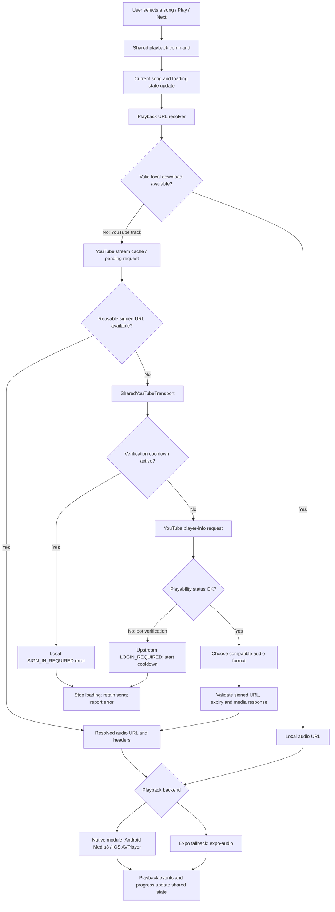

# Mavrixfy: YouTube verification aur playback failure ka detailed analysis

**Reviewed:** 13 October 2026  
**Scope:** Current local code, user-provided logs, aur official playback documentation.  
**Language:** Hinglish, with exact technical names where necessary.

## 1. Sabse important finding

Aapke latest log mein audio source resolve hone se pehle YouTube access reject ho raha hai:

```text
WARN [Player] Upstream requires verification for this track
cause: Error: Audio unavailable. LOGIN_REQUIRED: Sign in to confirm you’re not a bot
reason: sign_in_required
songId: youtube_G8Voqp9rR8E
```

Is request mein app ko usable audio stream return nahi hui. AVPlayer, Media3, buffering UI, progress bar aur StandBy transition is rejection ko solve nahi karte. Playback engine ko successful resolution ke baad hi URL hand over hoti hai.

**Confirmed:** Resolver ne upstream playability rejection propagate kiya.

**Not confirmed:** YouTube ne is device/session/network ko specifically kyun reject kiya. Is warning mein server ka internal detection reason nahi hai. Isse IP ban, permanent account restriction, token expiry, song removal, ya iOS decoder bug prove nahi hota.

## 2. Log ke har field ka meaning

- `WARN [Player]`: App ke playback command ka warning label. Yeh native AVPlayer error label nahi hai.
- `Audio unavailable`: Transport ne stream-resolution failure ko wrap kiya.
- `LOGIN_REQUIRED`: Player-info response ka non-OK playability status, jo resolver ne error mein convert kiya.
- `Sign in to confirm you’re not a bot`: Upstream rejection ka reason text.
- `reason: sign_in_required`: App ka broad classification. Yeh actual rejection aur local verification cooldown dono ko same category mein report kar sakta hai.
- `youtube_G8Voqp9rR8E`: App ka song ID; corresponding video ID `G8Voqp9rR8E` hai. Yeh token ya account ID nahi hai.

**Warning aana aur YouTube ko nayi request jaana ek hi cheez nahi hai.** Neeche actual rejection aur local cooldown ka difference diya hai.

## 3. Complete connection aur playback flow



### Step-by-step responsibilities

1. **Player UI** sends the existing Play/Next command. StandBy uses the same shared playback connection; it is not a separate audio engine.
2. **`audioPlaybackCommands.ts`** retires outgoing output and updates the selected song optimistically. A new title/artwork appearing does not prove that audio started.
3. **`usePlayerCoreState.ts`** coordinates URL resolution and next-song prefetch.
4. **`PlayerPlaybackResolver.ts`** first checks valid downloaded/local audio. A YouTube track then enters its YouTube-specific resolver lane. A YouTube failure does not silently turn into another provider's song.
5. **`YouTubeMusic.ts`** handles reusable stream URLs, deduplicated in-flight requests and per-song invalidation.
6. **`SharedYouTubeTransport.ts`** uses `youtubei.js/react-native` and an Innertube session to obtain stream information. This is the extraction path in the repository, not the official YouTube IFrame player.
7. Only after resolution succeeds does the command load the URL into the playback backend.
8. Native/fallback events update playback state, duration, position and completion handling.

Source references: [Playback commands](src/services/audio/audioPlaybackCommands.ts), [core state](src/services/audio/usePlayerCoreState.ts), [URL resolver](src/services/audio/PlayerPlaybackResolver.ts), [YouTube cache](src/services/youtube/YouTubeMusic.ts), [transport](src/services/youtube/SharedYouTubeTransport.ts).

## 4. Actual upstream rejection versus local cooldown

### A. Actual upstream rejection — your latest example

```text
Audio unavailable. LOGIN_REQUIRED: Sign in to confirm you’re not a bot
```

The resolver reads a non-OK playability status, throws its status/reason, and wraps that failure. The bot-verification text activates a shared **60-second** verification cooldown. Resolution stops at this point: the current loop does not continue switching client profiles after that terminal verification rejection.

### B. Local cooldown message — your earlier examples

```text
SIGN_IN_REQUIRED: Upstream verification required. Try again later.
```

`checkVerificationCooldown()` generates this exact text locally when `Date.now() < verificationBlockedUntil`. For this resolution attempt, the cooldown can prevent the new YouTube request entirely.

Therefore, repeated warnings for different songs during that interval do not establish that every song received a separate YouTube rejection. The cooldown is shared across audio/video resolutions using this transport. A next-song prefetch rejection can also activate it; the visible selected song is not necessarily the request that originally triggered the block.

The 60 seconds are an **app policy**, not a promise that YouTube will allow playback after 60 seconds. The current app does not schedule an automatic retry at the end of this verification cooldown. A later explicit Play attempt can resolve again; another upstream rejection can start a new cooldown.

## 5. Connections involved

There are several distinct connections, not one permanent music socket:

- **Catalog/metadata requests:** titles, artists, thumbnails, playlists and search results. Successful metadata requests do not prove playback access.
- **Player-info requests:** obtain playability status and available stream formats. Your latest warning concerns this access stage.
- **Attestation requests:** request a challenge and mint a proof token when the configured Web client path uses it.
- **Media CDN request:** fetch the signed audio URL, generally a `googlevideo.com` media URL for this provider. This is reached only after usable stream information is obtained.
- **Native decoder/audio session:** AVPlayer or Media3 opens the chosen source and handles output, buffering, focus and lifecycle.

A good Internet connection can still receive an access rejection. Conversely, valid access can still fail later because a URL expires, the media request fails, a file is truncated, or a decoder cannot open it.

The repository's transport uses `expo/fetch` with credentials omitted. Its session creation does not include a Google OAuth login in this path. Mavrixfy/Firebase login should not be assumed to authenticate the user to YouTube.

## 6. Token system: what it does and what it does not prove

The repository already contains a proof-token manager and a lazy WebView host:

- [YouTubePoToken.ts](src/services/youtube/YouTubePoToken.ts)
- [YouTubePoTokenHost.tsx](src/services/youtube/YouTubePoTokenHost.tsx)
- [YouTubePoTokenHtml.ts](src/services/youtube/YouTubePoTokenHtml.ts)
- [YouTubePoTokenHttp.ts](src/services/youtube/YouTubePoTokenHttp.ts)

### Current implemented behavior

- Tokens are held in memory and keyed by video ID within a visitor session.
- Cached tokens are reused only while their recorded lifetime is valid.
- A visitor change resets the manager's session state.
- Concurrent mint requests for the same video are deduplicated.
- Bootstrap has a 10-second command deadline; mint has a 3-second deadline.
- Reply format and expiry are validated locally.
- The cache is bounded to 200 tokens.
- After three counted attestation failures, token minting has a separate **15-minute cooldown**.
- Network-change handling resets token state and connection stream caches.

**There are two different cooldowns:** the transport's 60-second verification cooldown and the token manager's 15-minute repeated-attestation-failure cooldown. They are not interchangeable.

The host is a hidden attestation WebView, not a visible official YouTube video player and not a user sign-in screen. Its shared/third-party cookie options are disabled.

### Important limits

A locally valid token is not proof that YouTube accepted it. A token does not automatically satisfy a sign-in challenge. In the current transport, proof handling is attached to the `MWEB` client path; it is not supplied indiscriminately to `VISIONOS`, `ANDROID_VR`, `TV` and `WEB` requests.

The exact bot-verification rejection exits the current resolution attempt before further profile cycling or HTTP-access session refresh. Therefore, this warning does not establish that the proof host ran, failed, succeeded, or was even reached for this song.

Random strings, repeatedly resetting visitor state, or minting endlessly do not provide a reliable access guarantee. A fresh token is not an “undetectable” identity.

## 7. Native playback versus Expo fallback

### Native module available

The repository's native playback module uses Android Media3 ExoPlayer and iOS AVPlayer APIs. They handle the audio URL and playback lifecycle; they do not perform Google's sign-in verification.

### Expo Go or missing native module

`PlayerContext.tsx` enables the lightweight fallback when running in Expo Go **or when the native TrackPlayer adapter is unavailable**. `NativePlaybackPlayer.ts` uses an optional `MavrixfyPlayback` module outside Expo Go/web.

So a stack trace through `ExpoAvAdapter.ts` proves that the Expo fallback handled that attempt. It does not by itself prove the app is Expo Go: a development/build environment missing the native module can also fall back. The file's legacy name does not mean it uses `expo-av`; its implementation lazily loads `expo-audio`.

This distinction matters when diagnosing a “native IPA only” issue. Record the actual backend/build identity rather than guessing from the UI.

Sources: [PlayerContext](src/contexts/PlayerContext.tsx), [native adapter](src/services/audio/NativePlaybackPlayer.ts), [Expo adapter](src/services/audio/ExpoAvAdapter.ts), [Android engine](modules/mavrixfy-playback/android/src/main/java/com/mavrixfy/playback/PlaybackEngine.kt), [iOS module](modules/mavrixfy-playback/ios/MavrixfyPlaybackModule.swift).

## 8. Why `Cannot Open` is a different problem

```text
ERROR [Player] playSong failed [Error: Cannot Open]
ExpoAvAdapter.ts: reject(new Error(status.error))
```

This is a native audio-load rejection propagated by the Expo listener. The cited JavaScript line reports the error; it does not establish its underlying cause.

Possible causes, not confirmed for the user's failed attempt:

- Remote source became inaccessible or expired after resolution.
- Media request behavior differs between resolver validation and native playback.
- Downloaded/preloaded data is invalid or incomplete.
- Container/codec cannot be decoded by that platform/runtime.
- Native file identification or source loading failed.

The resolver already validates a fresh stream using a bounded open-ended GET, checks its media response type, and cancels the response body. That reduces invalid-source handovers, but does not guarantee the later native request succeeds. Cached stream reuse also does not perform a fresh validation GET on every selection.

The current iOS stream selection restricts audio to AAC-LC (`mp4a.40.2`) because of earlier reported timeline problems. That does not establish AAC-LC as the cause of the current verification warning.

## 9. Preload fixes already applied

[nextTrackPreload.ts](src/services/audio/nextTrackPreload.ts) previously saved every downloaded source with a generic `.audio` extension. A local AVPlayer URL does not carry the original HTTP Content-Type. The code also previously accepted a cached file if it merely existed and had nonzero size, even if it was truncated after download.

Changes now applied:

1. Download to a temporary `.download` path.
2. Validate successful full response, bounded file size, declared length where present, and reject HTML/JSON responses.
3. Derive a recognized media extension from MIME type or a recognized source extension.
4. Rename the complete file to that media extension before publishing it as ready.
5. Skip optional preloading if its container cannot be identified.
6. Store the validated size and reject a changed/truncated cached file at consumption time.
7. If an optional preload is unavailable, the adapter uses its original resolved source.

These are concrete preload corrections. **They do not prove that the particular reported `Cannot Open` was caused by preloading. They do not resolve `LOGIN_REQUIRED`.**

The preload is bounded to 20 MiB and a 25-second download window. Only a completed next-track file is eligible; preloading is not a separate audible player.

## 10. Current error and retry behavior

### Verification errors

- No rapid automatic queue advance.
- No per-failure reset of the global verification cooldown.
- No indefinite token-mint retry.
- Selected song is retained and loading/play intent is cleared with an error.
- A later explicit Play can retry resolution when allowed.

### Transient URL-resolution errors

- Eligible network/timeouts and selected HTTP failures have one bounded retry after 1.2 seconds.
- The first resolution deadline is 27 seconds for YouTube, 12 seconds otherwise; the retry deadline is 15 seconds.
- Authentication/verification and restricted/private/removed cases are excluded from this network retry.
- Selection/account/play-intent checks prevent an obsolete resolution from intentionally restarting a user-paused or replaced selection.

### Loaded playback

The native backend owns native buffering/lifecycle. The Expo fallback has separate bounded startup/stall handling and transient stream-recovery behavior in progress tracking. There is no additional fresh-source decoder retry loop added by the recent verification work.

Startup failures are owned by the pending playback command rather than launching another recovery from the status listener at the same time.

### UI

The extra Play-button spinners were removed at the user's request. Normal playback-buffer information and native buffering remain. A spinner would describe pending work; it would not fix authentication or manufacture playable bytes.

Sources: [commands](src/services/audio/audioPlaybackCommands.ts), [progress handling](src/services/audio/audioProgressTracking.ts), [Expo adapter](src/services/audio/ExpoAvAdapter.ts).

## 11. Network reset: what is actually detected

The token host compares a network key based on network type and connected state. A detected change resets attestation state and clears connection stream caches/cooldown. This protects against reusing a potentially stale connection-bound source.

This detector does not establish that every IP change or Wi-Fi access-point change will be detected. Changing/resetting network state is also not proof that an upstream restriction has disappeared. It should not be called repeatedly as an error bypass.

## 12. Official integration: what changes

The official YouTube IFrame API embeds a visible video player and exposes playback/queue controls and player events. It has a minimum player viewport requirement. It is a different integration from returning raw audio URLs to Media3/AVPlayer. [Official YouTube player documentation](https://developers.google.com/youtube/iframe_api_reference).

Using the official player would require product/UI changes. It is not a drop-in replacement for this native audio-only StandBy experience, nor a guarantee that every video is accessible.

For the existing native music-player design, the durable source architecture is an authorized audio provider, rights-controlled audio, or valid user-imported/local files. This still requires ordinary network/decoder handling; “authorized” does not mean technically failure-free.

Expo's audio APIs expose loaded/buffering state and support downloaded/local playback, but those APIs do not provide YouTube authentication. [Official Expo audio documentation](https://docs.expo.dev/versions/latest/sdk/audio/).

## 13. What cannot be concluded from this warning

The latest warning does **not** prove any of the following:

- The selected song was removed or is unavailable to all YouTube users.
- An iPhone-specific player bug caused access denial.
- Android is immune to the same server-side rejection.
- The device's IP address is permanently blocked.
- A proof token was definitely expired or missing.
- A token was minted and YouTube accepted it.
- Reinstalling, clearing app data or rotating tokens will fix it.
- Every repeated warning represents another network request.
- A prefetch rejection necessarily involved the visible selected song.

Network/session characteristics or request/client compatibility are possible investigation directions, not established explanations for this user's request.

## 14. Diagnosis procedure for the next failure

1. Record build/runtime and actual backend: native module or Expo fallback.
2. Capture the **first** failure with timestamp and song ID, before repeated Play taps.
3. Distinguish `Audio unavailable. LOGIN_REQUIRED...` from the local `SIGN_IN_REQUIRED...Try again later` message.
4. Determine whether the initial rejection came from explicit selection, next-track prefetch or a video resolution.
5. If the problem is verification, do not diagnose it as an AVPlayer load failure.
6. If the problem is `Cannot Open`, capture the newly added `[Audio] Preview load failed` diagnostic.
7. Keep source identity and selection generation consistent when comparing resolver and decoder observations.
8. Test a valid local/imported audio source separately to isolate backend playback from YouTube access.
9. After a failure, verify that Pause/Next does not revive an old selection and that progress belongs to the audible song.

New safe diagnostic fields:

- `songId`: the selected song.
- `source`: `prepared-file`, `remote`, or `local-file`.
- `expired`: true only when known expiry metadata is already past. False can mean metadata is absent; it is not proof of source validity.
- `reason`: shortened native load reason with HTTP URLs redacted.

The diagnostic does not expose signed URLs or headers. It also does not currently contain the native media GET's HTTP status or full iOS NSError domain/underlying error chain. A resolver GET success is not a substitute for those native failure details.

Do not share raw signed URLs, authorization headers, cookies or proof-token values when collecting logs.

## 15. Verification completed and remaining

Completed during the recent code work:

- Full regression suite: 550 tests passed after preload/diagnostic code changes, before the final new diagnostic test was added.
- Focused preload/startup suite including that final diagnostic test: 10 tests passed.
- TypeScript typecheck passed.
- ESLint on changed audio files passed.
- Tests cover recognized container extensions, unknown-container rejection, post-prefetch truncation, failure-source diagnostics, secret redaction and no new decoder retry loop.

Limits:

- Regression tests use controlled fixtures; they do not prove this specific YouTube track plays on a physical device.
- No physical Android device was listed by ADB during the last check.
- No new audible iPhone reproduction or native NSError capture was completed during these fixes.
- Windows cannot perform an Xcode/iOS native compile here.
- No evidence currently establishes the server's exact reason for rejecting this session.

## 16. Recommended actions, in priority order

1. Keep verification rejection, cooldown and decoder failure distinct in diagnostics and user-facing handling.
2. Keep terminal verification errors out of rapid retry/profile-reset/auto-next loops.
3. Validate the latest preload correction on the actual failing runtime.
4. Capture the first real rejection and source/backend details before changing more playback code.
5. Investigate native decoder HTTP/error details only for a source-load failure, not for pre-resolution verification denial.
6. For long-term supported playback, decide between a visible official YouTube player and an authorized native-audio source architecture.

**Final finding:** Your quoted warning is an upstream verification rejection during stream resolution. The app's subsequent local cooldown may explain later repeated warnings. The separate preload defects have been corrected, but the specific `Cannot Open` reproduction and YouTube's internal verification reason remain unconfirmed. No code change currently guarantees access to a server-rejected stream.

## 17. Additional scenario testing: 13 October 2026

### Controlled regression checks

The latest complete suite passed **558 tests, zero failures**. This is the full app regression count, not 558 independent live YouTube songs. TypeScript typecheck and ESLint on the relevant transport/token/preload/Expo adapter files passed.

Seven focused scenarios were added to `scripts/youtube-transport.regression.test.cjs`:

1. Android profile / Low quality: first-client verification rejection.
2. Android profile / Medium quality: first-client verification rejection.
3. Android profile / High quality: first-client verification rejection.
4. iOS profile / Low quality: first-client verification rejection.
5. iOS profile / Medium quality: first-client verification rejection.
6. iOS profile / High quality: first-client verification rejection.
7. A proof is minted and attached to MWEB, but the mocked upstream response still requires verification.

For cases 1–6, the test asserts one VISIONOS player-info attempt, zero token mints, zero media fetches, and a subsequent different-song request blocked by the local cooldown. These cases verify current behavior; passing them does not mean the rejected song plays.

Case 7 deliberately returns HTTP 403 from the initial direct client requests so that the existing MWEB path is reached. It verifies that the proof is attached, a later verification response stops resolution, and the next request does not keep minting or retrying. The upstream responses and proof are controlled fixtures, not live Google attestation.

The full suite also exercises existing scenarios across these independent layers:

- **Transport:** working direct profiles, preferred-client reuse, successful attested MWEB, media HTTP 403, alternate format selection, bounded session refresh, persistent rejection, request cancellation, validation timeout, signed URL/expiry checks, compatible iOS format selection, track-specific restriction versus shared bot-verification cooldown.
- **Token manager:** lazy bootstrap, concurrent same-video deduplication, separate video bindings, cached and expired tokens, visitor changes, late replies, network reset, missing host timeout, repeated-failure cooldown and timer cleanup.
- **Attestation bridge:** allowed interpreter/integrity targets, rejected arbitrary targets, and bundled BgUtils execution using a controlled interpreter fixture.
- **Playback handover:** retained selection on failure, no rapid automatic Next on verification, transient network retry, pause/selection cancellation, progress ownership and startup error ownership.
- **Preload:** complete versus partial download, response/file size mismatch, HTML response rejection, correct media extension, unknown container rejection, truncated/evicted cache, headers matching, queue replacement and active file lease retention.

Detailed automated output: [Full scenario test log](outputs/youtube-complete-scenarios.log).

### Live network probes

The actual repository transport was loaded through the existing Node probe adapter. It used Node/global fetch and platform-selection profiles; it did not run on an Android/iPhone device. The probe has no native WebView attestation host and does not play audible audio or download the complete song.

Initial sandbox attempts returned `fetch failed`; a direct connectivity diagnostic returned `EACCES`. Those results were environmental and are not counted as evidence of a YouTube verification rejection. Read-only probes were then rerun with network access.

**Android selection profile, network-enabled Node run:**

- `G8Voqp9rR8E`: failed after approximately 507 ms with `Audio unavailable. LOGIN_REQUIRED: Sign in to confirm you’re not a bot`.
- `NNpVL7xauj8`, immediately afterward in the same transport instance: failed after approximately 1 ms with the local `SIGN_IN_REQUIRED: Upstream verification required. Try again later.` message.

**iOS selection profile, separate network-enabled Node run:**

- `G8Voqp9rR8E`: failed after approximately 522 ms with the same upstream `LOGIN_REQUIRED` reason.
- `NNpVL7xauj8`, immediately afterward in the same transport instance: returned the local cooldown message in less than 1 ms.

Raw safe summaries: [Android Node probe](outputs/youtube-live-android.json), [iOS Node probe](outputs/youtube-live-ios.json).

The second song's immediate rejection is not evidence of a separate player-info rejection for that video. It confirms the shared cooldown behavior following the first actual rejection. The probes did not force-reset that cooldown between those two songs.

### Findings and limits after these tests

**Now reproduced:** the quoted upstream bot-verification rejection and subsequent local cooldown occur on this workspace's desktop network with the actual transport. Both platform-selection profiles stop before native media loading; changing decoder format cannot affect this observed rejection stage.

**Still not established:** why YouTube rejected the request internally, whether this phone/network receives the same result now, whether a real native WebView proof was minted/accepted, or whether attested MWEB can play this exact song on a physical device.

**Physical-device status:** ADB listed no attached Android phone in this test turn. No physical Android/iOS Play/Pause/Next, complete-song, background or audible output test was completed in this turn.

No production transport/client-order/cooldown changes were made as part of this testing request. Next meaningful verification is a real native-runtime attestation trace that records client, mint outcome and proof-attached status without exposing token values. Mocked token success and a Node probe without a token host cannot replace that check.
