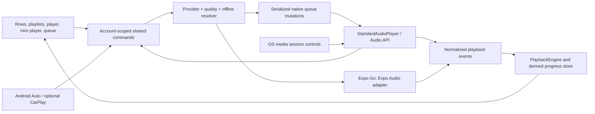

# Mavrixfy production audio audit, remediation and verification

Audit date: **2026-10-10, Asia/Calcutta**. Initial revision: `4a6b64c` (`production finale`), with a clean working tree. During verification, the shared workspace advanced to `1186177` (`testing`), which contains the audit changes, and acquired additional package/player/home/karaoke edits. Those concurrent edits were preserved. The change inventory below attributes only this audio audit's work; checks of the final shared tree may also include concurrent work. No commit, deployment, dependency upgrade or publication was performed by this audit.

**Result:** confirmed playback, queue, account, download and native lifecycle defects were corrected. Automated behavior checks and Android builds provide useful evidence, but **production device readiness is not established**. Android lock-screen/background/focus/routing and iOS compilation/device behavior require the recorded device matrix. No real device scenario was executed here.

Deliverables A–E are covered below. Detailed supporting investigations are in [application flow](audio-audit/application-flow.md), [native integration](audio-audit/native-integration.md), and [streaming/effects](audio-audit/streaming-effects.md). The root verification table supersedes intermediate test counts in those appendices. [The device matrix](audio-device-test-matrix.md) defines all 18 requested scenarios, observations, and remaining acceptance steps. Command logs are retained in ignored `outputs/audio-audit/` and `android/audio-audit-*-build.log`; they are evidence on this workstation, not committed application code.

## A. Discovery and active architecture

Read configuration/dependency/lock/build files, searched active and historical playback references across application, plugins, generated Android, tests, patches and installed native package source, and followed dynamic imports/framework registration. Latest history and baseline checks were inspected before editing. No `AGENTS.md` was found in the repository or its parents. Large UI files were traced at playback actions, subscriptions and imports; this is not a claim to audit unrelated layout/business logic.

### Actual versions and supported runtimes

| Component | Installed/locked at discovery | Consequence |
| --- | --- | --- |
| Expo / React Native / React | 57.0.27 / 0.86.3 / 19.2.3 | Historical SDK 54 / RN 0.81 examples do not describe this build. |
| Expo Audio / Audio API | 57.0.5 / 0.13.6 | Two necessary runtime adapters, selected mutually exclusively. |
| Expo Router / TypeScript | 57.0.25 / 6.0.3 | Strict compiler configuration; current routing mounts one root provider. |
| Zustand / React Query | 5.0.15 / 5.101.4 | Catalog/UI state tools; neither constructs a second audio decoder. |
| Expo FileSystem / youtubei.js / Firebase | 57.0.6 / 18.1.0 / 12.16.0 | Installed contracts/source checked for cancellation, extraction and callable error codes. |
| AndroidX Media compat / Expo's Media3 | 1.7.0 / 1.9.0 | Custom player uses MediaSessionCompat, not an active Media3 player/service. Media3 is brought by Expo Audio. |
| Android toolchain | AGP 8.12.0; Java 17.0.17; min 24, target 36, compile 37 | Build warnings about AGP's tested compile SDK are retained. |
| Track Player / expo-av | Neither dependency installed | `TrackPlayer` variables and `ExpoAvAdapter` filename are historical names, not additional engines. |

`app.json` declares Android and iOS. Custom native/development/EAS builds use Audio API's `Audio` component, FFmpeg decoder, one shared `AudioContext` and the equalizer graph. Expo Go uses `expo-audio`; custom JSI imports are gated so Expo Go never evaluates Audio API installation. Web has a fallback code branch but is not a declared supported deployment target. The standby Expo player is silent preparation owned by the adapter, not an independent audible player.

Repository patches cannot modify a stock Expo Go binary. In particular, the Expo iOS remote-target fix and existing native timeline patch require a rebuilt binary/upstream Expo Go release. Equalizer, Android Auto and custom native notification controls require the custom build.

### Authoritative command/state flow

One `PlayerSessionProvider` is mounted inside the navigation root and keyed by Firebase UID. It owns commands, request IDs, queue coordination, persistence and teardown. `StandardAudioRenderer` owns the sole native audio graph/source; it is not created by the player screen. Normal screen navigation therefore does not recreate audio.

`StandardAudioPlayer` is authoritative for decoder status, active native queue occurrence, position/duration and native output intent. `PlaybackEngine` is the normalized external presentation snapshot; synchronous core refs coordinate commands and React context consumers. The progress store is derived timeline state. They are not physical playback implementations. UI `isPlaying` can represent requested playback during loading; `isLoading`/`isBuffering` and native events distinguish requested playback from actual decoder output. Native states remain `none`, `loading`, `buffering`, `playing`, `paused`, `stopped`, `ended`, `error`; no speculative recovering/ready/initializing state was added.

Selections reserve identity/index before async work. Request/selection/intent/account generations reject stale results. Queue changes run through one mutation-only `Promise<void>` lane. Native events preserve an explicit occurrence index, including duplicate IDs. Remote play/pause/stop/next/previous enter app handlers when registered; the singleton engine uses a fallback only if no app handler exists. Remote seek is seconds-based; UI seek converts the fraction to seconds. Skip intervals are disabled in the custom notification, while seek-to and queue navigation have distinct callbacks.

### Components inspected and necessity

All entries remain required unless a removal is explicitly listed. Supporting inventories list screen entry points and individual native package files in more detail.

| File/group | Purpose and playback participation |
| --- | --- |
| `package.json`, lockfile, `.npmrc`, `app.json`, `app.config.js`, `eas.json`, `tsconfig.json`, `metro.config.js`, `index.js`, `app/_layout.tsx` | Dependency/runtime selection, strict typing, bootstrapping, provider and native configuration. |
| `src/contexts/PlayerContext{,Defs,Providers}.tsx/.ts`, `src/types/playbackTypes.ts` | Runtime choice, shared account session, action/browse/row contracts, renderer ownership. |
| `src/contexts/AuthContext.tsx`, `src/lib/accountScope.ts`, `src/lib/storage.ts` | Authentication generation and account-specific persistent state. |
| `StandardAudioPlayer.tsx`, `StandardAudioRenderer.tsx`, `ExpoAvAdapter.ts` | Native singleton/decoder graph and thin renderer wrapper; Expo Go creation/readiness/standby/disposal. All remain active. |
| `PlaybackEngine.ts`, `playbackProgressStore.ts`, `audioTimeline.ts` | Deduplicated presentation/progress snapshots and actual-stream timeline normalization. Not redundant engines. |
| `usePlayerCoreState.ts`, `audioPlaybackCommands.ts` | Initialization, cache/preparation/autoplay coordination, play/pause/next/previous/seek and request ownership. |
| `audioNativeQueueLane.ts`, `audioQueueOperations.ts`, `queueDrag.ts` | Ordered mutations, canonical shuffle queue, repeat, insertion/removal/reorder and expected-snapshot validation. |
| `audioStartupReconcile.ts`, `audioSyncListeners.ts`, `audioProgressTracking.ts` | Startup/foreground restoration, native event subscriptions, completion/errors, progress and Expo completion. |
| `audioQualityControl.ts`, `audioPlaybackValues.ts`, `audioLikedSync.ts` | Quality reload of exact occurrence, stable context values, account-scoped liked subscription. |
| `audioSleepTimer.ts`, `sleepTimerDuration.ts`, `smartAutoplayService.ts` | One duration/end-of-queue timer; validated picker values; bounded/deduplicated catalog/YouTube recommendations. |
| `PlayerPlaybackResolver.ts`, `src/lib/musicData.ts`, `searchRepository.ts`, `utils/{asyncUtils,timeFormatters}.ts` | Metadata/source normalization, entitlement-aware quality, network selection, provider and managed-file validation. |
| `audioEqualizer.ts`, `equalizerConfig.ts`, `equalizerDsp.ts`, `lib/equalizerPreviewStore.ts` | Settings/revision ownership, 15-band peaking filters, headroom, bypass and graph application. No confirmed effects defect required edits. |
| `src/services/player/playerPersistenceService.ts` | Account-keyed queue/current-track/position facade; restoration is paused after process death. |
| `src/services/youtube/{YouTubeMusic,SharedYouTubeTransport,YouTubeVideoFormats,runtime}.ts` | Active JS extraction, coalesced quality/expiry caches, compatible format candidates and bounded transport. |
| `src/services/youtube/YouTubePoToken{,Host,Html,Http}.ts/.tsx` | Token generation/host lifecycle and provider request support. Required for extraction, not another player. |
| `src/services/youtube/{officialMusicVideo,YouTubeArtwork,YouTubeArtists,YouTubeHomeRecommendations,YouTubePlaylistIdentity}.ts` | Visual-video lookup, artwork/catalog identity and discovery/recommendations that supply queue metadata. |
| `src/lib/downloads/{audioQuality,downloadManager,downloadQueue,downloadStore,filesystem,licenseSync}.ts` | Provider download URLs, queue status/concurrency, transport/filesystem, local authorization and license lifecycle. |
| `src/lib/downloads/{collectionMetadata,deviceInfo,entitlement,storagePolicy}.ts` | Download metadata, device/entitlement policy and actively imported compatibility re-export. Retained. |
| Player/queue/mini-player screens and hooks; `SongRow.tsx`, `PlayerSlider.tsx`, karaoke views; home/search/library/playlist/artist/download actions | Consume shared snapshots/actions. Carousel selection preserves selected queue objects; progress consumers do not create players. Detailed entry-point table is in application appendix. |
| `BackgroundYoutubeVideo.tsx`, `useBackgroundVisualVideo.ts`, `services/notificationService.ts` | Muted visual video (volume 0, mixWithOthers, no background/Now Playing), and separate ordinary push/update notifications. Neither is a competing audible music engine/media notification. |
| `useAndroidAuto.ts`, `services/carPlayService.ts` | Catalog/remote-command bridge and optional native CarPlay facade; listeners/search cleaned. No native CarPlay implementation/entitlement was found for this build. |
| `plugins/withAndroidAuto.js`, `plugins/android-auto/*`, generated Kotlin/XML/drawables | Framework-registered car browser/module/package and shared media-session integration. No decoder in car browser. |
| `plugins/withYouTubeMusic{,IOS}.js`, `plugins/youtube-music/*`, generated native extractors | Still registered legacy URL providers and smoke tests. Few/no active JS calls are not proof that native registration can be deleted safely. Retained; they do not create competing players. |
| `android/{build.gradle,gradle.properties}`, `android/app/{build.gradle,proguard-rules.pro,src/main/AndroidManifest.xml}`, `MainApplication.kt` | Services/permissions/native packages, SDK targets, dependency/linking/minification/signing configuration. |
| `patches/{react-native-audio-api+0.13.6,expo-audio+57.0.5}.patch`, installed Android/iOS/C++/TS package sources | Exact-version bridge, event, notification/focus/route, remote-target, EOF/timeline and native build contracts. Preserved existing fixes. |
| `.github/workflows/ios-build.yml` | Existing macOS/Xcode/CocoaPods/prebuild/unsigned iOS verification route. Inspected, not executed from Windows. |
| `scripts/*.regression.test.cjs`, playback VM fixtures and native smoke/config tests | Deterministic behavioral evidence and build configuration checks; not OS/device test substitutes. |

## B. Confirmed defects, plan and implementation

The prioritized plan was: (1) reproduce command/source/state races, (2) fix queue/account/restore ownership, (3) repair native lifecycle/control ownership using installed APIs, (4) fix source/download/quality policy defects, (5) remove proven redundancies, (6) rerun all feasible checks and record device gaps. This keeps the existing decoder/effects/car architecture and product behavior. There was no engine replacement or Media3 migration.

No confirmed Critical defect was assigned. High findings were fixed as described, with platform execution limitations stated rather than declared verified.

| ID / severity | Confirmed behavior before remediation | Correction and evidence |
| --- | --- | --- |
| F1 High | Expo Pause left start-confirmation timers active; delayed timeout could report an error/recover after explicit Pause. Native play/pause exceptions were swallowed. | Cancel only startup confirmation on Pause, preserve paused player/readiness; dispose cancels both waits; propagate command errors and real SDK readiness errors. New engine behavioral tests failed before fixing these paths. |
| F2 High | Rapid native Next used outgoing index while target resolution was pending; reorder during resolution discarded/misplaced the selected result. | Reserve target/index before awaiting; merge at the current active occurrence after reorder, guarded by selection generation. Rapid Next/reorder regressions pass. |
| F3 High | Replay after Ended/Error could operate a retired source; delayed Stop or replay could overwrite newer Play/Pause. | Reload source from start/current error position; selection/intent guards preserve newer commands. Stop only publishes terminal state if its intent is current. Engine tests cover all three races. |
| F4 High | Managed revoked/non-completed local records could enter orphan recovery/direct URL/cache/native fast-skip paths; automatic advance could open an already queued revoked file. | Gate managed local authorization in manager, resolver, cache, native queue URL equality and native selection. Automatic advance publishes selected-track identity before reporting denial so the UI accepts the error. No revoked source is published to Audio in the regression. |
| F5 High | Fast toggle latch dropped commands; delayed init/read/catch/terminal-pause/seek could affect a newer request, including the same song ID. | Remove latch; request/song/intent checks after awaits, including end-of-queue and seek. Application/seek tests reproduce ordering and now pass. |
| F6 High | Startup/foreground/storage reads could overwrite current selection or restored index; account changes retained outgoing audio/cache/queue and cleanup could persist into new account. | Startup only restores untouched account/request; native occurrence respected; UID-keyed session teardown plus captured-scope guards for deferred persistence and queue work. Account/startup/lane regressions pass. |
| F7 High | JS index removal against an unsynchronized native queue could remove the playing sole native item. | Require matching native order for direct removal; otherwise rebuild preserving live track/position. Reject invalid/fractional indices. Behavioral removal/lane tests pass. |
| F8 High | Android lacked noisy-output receiver despite a route-change consumer; focus denial produced no interruption; shared callbacks captured outgoing bridge. | Add one owned ACTION_AUDIO_BECOMING_NOISY receiver, publish existing interruption on denied focus, resolve current bridge on shared callbacks. Native Kotlin/debug/release compilation and source inspection support implementation; physical routing/event timing are NOT TESTED. |
| F9 High | iOS late artwork completion could overwrite new-track metadata or resurrect metadata after hide. | Cancellable URLSession task, 10-second timeout, artwork generation/active guard; missing art clears old art. Main queue serializes notification lifecycle. Exact installed source and patch replay checked; iOS build/device NOT TESTED. |
| F10 High | Prefixed Firebase callable denial codes were classified as unavailable server and generated a local license. | Normalize `functions/` then deny explicit permission/quota/auth failures; preserve existing unavailable-endpoint policy. Seven license regressions and installed constructor source establish behavior. |
| F11 Medium | Duplicate IDs selected/reloaded first occurrence; shufflePlay overwrote canonical order; repeat snapshot lagged context. | Object/index occurrence checks, canonical order reservation, synchronous repeat snapshot. App-flow/quality/live queue regressions pass. |
| F12 Medium | Stale progress tick erased effective seek override; persisted progress could resurrect during fresh Play(0); errors/queue timer retained loading or resume intent. | One owner for effective progress, startup-only progress restore, consistent terminal desired/loading/error values. Progress/application/sleep tests pass. |
| F13 Medium | Stop/queue exhaustion retained notifications; notification finalizer could lose last pending update; native hide retained shared metadata/controls. | Hide genuine terminal states, retain Pause, drain pending finalizer work; clear native metadata and playback actions while retaining car token. Engine termination regressions and compiled native code support changes. |
| F14 Medium | Expo standby was reused for matching URL with different authorization headers; Expo native loaded status was inferred solely from object presence. | Match URL and serialized headers; expose actual isLoaded; use typed lock-screen APIs and retain useful failure diagnostics. Engine regressions pass. |
| F15 Medium | Bridge invalidation leaked receivers/focus/registry, iOS observers/notification operations raced, Expo remote closure targets accumulated. | Owned/idempotent cleanup, current bridge guard, main-queue iOS lifecycle, retain/remove returned MPRemoteCommand tokens. Exact-version source reviewed; Android compiled; iOS execution deferred. |
| F16 Medium | Pause/cancel could be undone by late download resolution/failure/promotion; cancel released slot before task finished; refresh timeout excluded JSON body. | Persist intent first, expected-status/suspension checks, sole finalizer releases slot, remove abandoned promoted files, timeout includes body. Three retries at 2/5/10 seconds remain bounded; fourth failure terminal. Download regressions reproduced original/final-promotion failures. |
| F17 Medium | Quality ranked 160 above valid 256; raw URL fabricated bitrate; arbitrary signed download URL text was rewritten. | Numeric candidate ordering, unknown remains Original audio/0, rewrite only verified provider CDN path and preserve signed query bytes. Source/download regressions pass. |
| F18 Low | Prebuild could re-enable inactive Expo service; unused compatibility branches/declarations/historical keep rules and stale performance fixtures remained. | Idempotent service config plugin, documented removals below, tests execute current QueueBottomSheet/PlayerScreen. Config/performance/type/lint checks pass. |

### Native/session findings and limits

Android uses Audio API's one `CentralizedForegroundService` with mediaPlayback type and one shared MediaSessionCompat token. Android Auto's MediaBrowserServiceCompat publishes catalog/commands and shares that token; it is not an extra notification or player. Expo Audio's `AudioControlsService` is disabled in generated custom manifests and now remains disabled across prebuild. The plugin regression executes its manifest modifier twice and checks one browser/automotive metadata entry. Foreground-service permissions remain; POST_NOTIFICATIONS remains necessary for ordinary app notifications. Android's media-session notification permission exemption was checked rather than used as a reason to delete ordinary notification permission.

Focus/interruption policy remains the SDK/app policy: permanent loss pauses without automatic resume; transient resume requires platform `shouldResume` plus unchanged intent; user Pause/route loss blocks later resume; duck attenuates through the existing graph and restores. The native focus API returns void. The denial event cancels on delivery; the immediate-event regression **does not prove that asynchronous bridge delivery prevents a brief output start**. Also, native notification `show` resolves after requesting the service, not after OS `startForeground`; Android 15+ eligibility for a stopped/background/car start is not established. These are explicit device/release validation gaps, not claims of guaranteed focus compliance. No speculative readiness callback contract or second focus controller was introduced.

iOS config includes background audio and Audio API playback category. SDK native route/interruption/reset observers, metadata/remote commands and activation/deactivation paths were inspected. No generated `ios/` project or Xcode exists on this Windows host. Use the existing macOS workflow/EAS/custom prebuild route to compile the Objective-C/Swift patches and test actual iOS output. Apple documents `MPNowPlayingInfoCenter.playbackState` as macOS; a suspected always-paused iOS bug was rejected, not reported as fixed. iOS rate/elapsed metadata remains authoritative. Native CarPlay is unavailable in this repository build; its guarded JS facade was retained.

### Removals and retained compatibility

| Removed declaration/branch | Why removal is safe |
| --- | --- |
| Production CommonJS `StandardAudioRenderer` test alias | Actual app imports `StandardAudioRenderer.tsx`; VM fixture now aliases exported renderer hook itself. No production caller of this alias. |
| `togglePlayInFlightRef` | Dropped real commands and was superseded by current request/intent checks; all references removed. |
| Old reset/add/optional seek interface feature detection | Injected native player is the known StandardAudioPlayer type with required setQueue/load/seek methods. One-track load fallback remains for incomplete queue sources. |
| Redundant initial-position seek | setQueue/load already accepts initial seconds; verified through queue/seek tests. |
| Unused audioProgress TrackPlayer and audioSync next/prev options | No body reads; single context call sites updated; compiler unused check confirms removed declarations. |
| Unused carousel next/prev inputs and player styles/useMemo/GHPressable/Song imports | Carousel directly selects the target with playSong; reference search and unused compiler evidence; no UI layout change. |
| `QUALITY_LADDER`, unreachable parseBitrate literal fallback map | Whole-repository references found only definition; prior numeric regex already handles all literal keys. |
| Two patched unused native static session hooks; captured stale module import/constructor | No registrations/callers; current bridge registry owns dispatch. Native patch/source/build checked. |
| iOS macOS-only playbackState write branch | Ineffective on iOS according to Apple docs; playback rate metadata preserved. |
| `com.doublesymmetry.**` Proguard rule in config and generated file | Track Player package/native registrations absent; no matching app/native implementation; shrinking release build checks removal. |

No active adapters, registered extractor/plugin/native packages, background capabilities, equalizer, timers, analytics/accessibility paths or dependencies were deleted. `storagePolicy` is an active re-export. Historical variable/file names are retained to keep this correctness change small; they do not prove a hybrid engine.

### Subscription/resource ownership

| Resource | Owner / lifetime / disposal |
| --- | --- |
| Audio graph/source/filter/gain/watchdog | Root renderer + native singleton; source generations retire old decoder, reset invalidates intent, unmount disconnects graph/closes context/clears watchdog. |
| SDK system/notification listeners | Standard singleton installs once per process setup; account session removes app consumers; current-bridge native cleanup owns OS resources. Not reinstalled by player-screen mounts. |
| Normalized native app listeners | audioSyncListeners owns returned subscriptions and removes each during effect cleanup. Some dependency changes still reinstall the effect; no demonstrated duplicate registration remains. |
| Expo status/native preparation waits | One active callback, per-player removable subscriptions, generations, separate readiness/start cancellation; standby/active disposed by adapter/session. |
| AppState subscriptions | Distinct background persistence and foreground reconciliation owners; both remove subscriptions and guard account/identity after reads. |
| Android receivers/focus/registry | Current Audio API installation; cleanup checks owner, removes noisy/media/volume receivers, abandons focus and clears registry. Shared car session token intentionally survives bridge replacement. |
| Car listeners/catalog/search | Native module + useAndroidAuto; invalidation/JS cleanup clear actions/catalog/listeners, abort active search. Optional CarPlay subscriptions remove on teardown. |
| iOS system observers/optional timers | SystemNotificationManager cleanup removes observers, volume/interruptions and optional secondary-audio timer. |
| iOS artwork and remote commands | Notification generation/cancellable task, hide/cleanup; Expo controller stores command/token pairs and removes its opaque targets. |
| Sleep timer / gesture cooldown | Hook-owned single timeout, cleared on replacement/clear/unmount. Sleep duration is JS based and not process-independent. |
| Download tasks/retries | Queue's single finalizer releases concurrency; intent/status guards suppress abandoned completion/retry; retries bounded. |
| Progress/UI subscribers | External stores deduplicate values; inactive UI unsubscribes; decoder event processing continues. Event-driven native progress and Expo SDK updates retained; no new polling loop. |

## C. Per-file change summary

This lists **every file modified or added by the audit**, including changes already captured in `1186177`. Concurrent subsequent edits are outside this inventory. No whole file was removed. Verification abbreviations: **T** full automated suite; **TS** strict typecheck; **L** lint; **N** Android compilation/assembly; **P** exact patch reverse dry-check; **R** source/reference/diff review. Device claims are never implied by these abbreviations.

| File | What changed, reason, verification |
| --- | --- |
| `src/services/audio/StandardAudioPlayer.tsx` | Pending selection/index ownership, managed-local selection/error identity, replay/Stop guards, finite seek rejection, terminal notification/finalizer drain, intent-before-focus, deliberate async diagnostics, native interface type and removal of test alias. F2–4/F8/F13; T/TS/L/R. |
| `src/services/audio/ExpoAvAdapter.ts` | Pause startup wait cancellation, typed actual loaded/lock-screen methods, SDK errors, standby header identity. F1/F14; T/TS/L/R. |
| `src/services/audio/PlayerPlaybackResolver.ts` | Prevent rejected managed-file fallback resurrection, infer track shape and remove unreachable duration aliases. F4; T/TS/L. |
| `src/contexts/PlayerContext.tsx` | UID-keyed inner session; pass restore request ref, remove unused options; log session/timer cleanup failures instead of silently discarding them; preserve current engine/runtime composition. F6/F12/F18; T/TS/L/R. |
| `src/services/audio/usePlayerCoreState.ts` | Typed native engine/state/repeat interfaces, managed local cache revalidation, remove obsolete toggle latch. F4/F5/F18; T/TS/L. |
| `src/services/audio/audioPlaybackCommands.ts` | Live request/intent/account guards, source identity fast-path check, selected object occurrence, delayed terminal/seek guards, remove obsolete compatibility branches. F4–7/F11; T/TS/L. |
| `src/services/audio/audioNativeQueueLane.ts` | Void mutation lane; account cancellation; rebuild known native interface preserving current track/position/intent. F6/F7; T/TS/L. |
| `src/services/audio/audioQueueOperations.ts` | Canonical shuffle preservation, repeat snapshot, safe native removal/indices and account guarded mutation/persistence. F7/F11; T/TS/L. |
| `src/services/audio/audioStartupReconcile.ts` | Stale request/account protection; active occurrence and persisted current-track/index reconciliation. F6; T/TS/L. |
| `src/services/audio/audioSyncListeners.ts` | Duplicate index identity, single effective progress write, guarded foreground/persistence, consistent terminal intent/loading/error, remove unused inputs. F6/F11/F12; T/TS/L. |
| `src/services/audio/audioProgressTracking.ts` | Startup-only saved position and late-result request guard; consistent error intent; unused player option removed. F12; T/TS/L. |
| `src/services/audio/audioQualityControl.ts` | Typed engine and preserve native duplicate occurrence while reloading quality. F11; T/TS/L. |
| `src/features/player/hooks/usePlayerLiveQueue.ts` | Preserve valid active occurrence index before ID lookup. F11; T/TS/L. |
| `src/features/player/hooks/usePlayerQueueCarousel.ts` | Remove unread nextSong/prevSong options; selection still uses playSong. F18; TS/L/R. |
| `src/features/player/hooks/useLegacyPlayerViewState.ts` | Remove corresponding unused carousel arguments only. F18; TS/L/R. |
| `src/features/player/components/PlayerBottomDetailsSection.tsx` | Remove unused styles import. F18; TS/L/R. |
| `src/features/player/components/PlayerDiscoverySections.tsx` | Remove unused useMemo/gesture Pressable imports. F18; TS/L/R. |
| `src/features/player/screens/PlayerScreen.tsx` | Remove unused Song type import only. F18; TS/L/R. |
| `src/lib/musicData.ts` | Numeric quality ranking, honest unknown bitrate, delete dead ladder/map. F17/F18; T/TS/L. |
| `src/lib/downloads/audioQuality.ts` | Restrict quality rewriting to verified provider CDN pathname; preserve signed bytes. F17; T/TS/L. |
| `src/lib/downloads/downloadManager.ts` | Reject managed non-completed records; account checks after file I/O; reuse grace constant. F4; T/TS/L. |
| `src/lib/downloads/downloadQueue.ts` | Intent-first pause/cancel, sole slot finalizer, bounded body timeout and guarded promotion/completion; remove abandoned promoted files. F16; T/TS/L. |
| `src/lib/downloads/licenseSync.ts` | Normalize Firebase denial prefix before fallback classification. F10; T/TS/L/R. |
| `plugins/withAndroidAuto.js` | Idempotently disable inactive Expo service through regeneration. F18; T/L/config/N. |
| `plugins/android-auto/MavrixfyMediaLibraryModule.kt` | Guard queue index conversion and refresh published controls after queue/active updates. F11/F15; R/N. |
| `android/app/src/main/java/com/mavrixfy/app/MavrixfyMediaLibraryModule.kt` | Matching generated Kotlin changes, kept in parity with plugin source. R/N. |
| `patches/react-native-audio-api+0.13.6.patch` | Current-bridge dispatch, noisy/focus event handling, owned cleanup, native terminal metadata, iOS lifecycle/artwork generation; preserve existing C++/TS/build fixes. F8/F9/F13/F15; P/R/N; iOS uncompiled. |
| `patches/expo-audio+57.0.5.patch` | Retain/remove remote command opaque targets, preserve existing timeline/seek fixes. F15; P/R; iOS uncompiled. |
| `app.json` | Remove historical Track Player keep rule only; preserve audio modes/permissions/services/plugins. F18; config/N/R. |
| `android/app/proguard-rules.pro` | Same historical keep-rule removal in generated native configuration. F18; N/R. |
| `scripts/audio-engine-audit.regression.test.cjs` (new) | 12 behavioral cases covering adapter pause/errors/headers, invalid indices/seek, rapid/reordered selection, Stop/focus events, termination/replay and revoked auto-advance/error order. T. |
| `scripts/audio-app-flow.regression.test.cjs` (new) | 22 behavioral hook cases for toggle/startup/account/queue/duplicates/state/expired-source/terminal races. T. |
| `scripts/download-audio.regression.test.cjs` (new) | 15 quality/file/account/download/timeout/promotion cases. T. |
| `scripts/offline-license.regression.test.cjs` (new) | Seven explicit-denial vs unavailable-fallback cases. T. |
| `scripts/audio-progress.regression.test.cjs` | Request/persisted-read fixture and fresh-play/late-restore regressions. T. |
| `scripts/audio-seek.regression.test.cjs` | New same-song newer-request stale seek case. T. |
| `scripts/audio-source-quality.regression.test.cjs` | Managed revoked URL fallback regression. T. |
| `scripts/quality-change.regression.test.cjs` | Duplicate occurrence quality reload plus current fixture contract. T. |
| `scripts/queue-mutation.regression.test.cjs` | Account cancellation cases and current queue fixture. T. |
| `scripts/queue-reorder.regression.test.cjs` | Account-scope fixture support for typed guarded queue code. T. |
| `scripts/expo-playlist-flow.regression.test.cjs` | Account-scope fixture support. T. |
| `scripts/media-playback.regression.test.cjs` | Assert nonfinite seek rejects, rather than silently returning success. T. |
| `scripts/android-auto.regression.test.cjs` | Executes actual plugin twice and verifies single service/catalog configuration. T. |
| `scripts/performance.regression.test.cjs` | Fix two baseline stale fixtures; execute current virtualized 10,000-item QueueBottomSheet and current PlayerScreen dependencies. T. Subsequent concurrent changes are not attributed here. |
| `scripts/helpers/audio-player-fixture.cjs` | Test-only renderer alias, exposed focus boundary, notification-hide count, injected local validation. T. |
| `scripts/helpers/expo-player-fixture.cjs` | Logger warning mock for meaningful new diagnostics. T. |
| `explain/audio-engine-audit.md` (new) | Complete A–E findings/change/verification/readiness artifact; source/log cross-check. R. |
| `explain/audio-device-test-matrix.md` (new) | All 18 device scenarios and category/extended acceptance coverage; no fabricated observations. R. |
| `explain/audio-audit/application-flow.md` (new) | Detailed app inventory, entry points, races, ownership and scoped evidence. R. |
| `explain/audio-audit/native-integration.md` (new) | Installed native source/config inventory, lifecycle fixes, docs/build evidence and physical limitations. R. |
| `explain/audio-audit/streaming-effects.md` (new) | Provider/download/effects/dependency investigation and scoped evidence. R. |

The tracked patches also carry these installed-package source changes. Paths below are relative to the relevant `node_modules` package; these are persisted through patch-package rather than committed node_modules files.

| Package source | Audit change / verification |
| --- | --- |
| Audio API `android/src/main/java/com/swmansion/audioapi/AudioAPIModule.kt` | Owned initialization/invalidation and notification/focus/registry cleanup. N/P/R. |
| Audio API `android/src/main/java/com/swmansion/audioapi/system/AudioFocusListener.kt` | Emit existing interruption event when the platform denies focus. N/P/R; actual delivery timing untested. |
| Audio API `android/src/main/java/com/swmansion/audioapi/system/MediaSessionManager.kt` | Current installation ownership, one noisy receiver, cleanup and current-bridge dispatch; remove unused hooks. N/P/R. |
| Audio API `android/src/main/java/com/swmansion/audioapi/system/notification/NotificationRegistry.kt` | Release registered notification ownership during bridge cleanup. N/P/R. |
| Audio API `android/src/main/java/com/swmansion/audioapi/system/notification/PlaybackNotification.kt` | Dispatch through current bridge; terminal metadata/action cleanup, remove stale captured constructor ownership. N/P/R. |
| Audio API `android/src/main/java/com/swmansion/audioapi/system/notification/PlaybackNotificationReceiver.kt` | Current bridge reference/owned cleanup for remote controls. N/P/R. |
| Audio API `ios/audioapi/ios/AudioAPIModule.mm` | Serialize notification show/hide/active/cleanup on main queue. P/R; iOS build untested. |
| Audio API `ios/audioapi/ios/system/SystemNotificationManager.mm` | Remove owned observers, volume/interruption observation and optional timer. P/R; iOS build untested. |
| Audio API `ios/audioapi/ios/system/notification/PlaybackNotification.mm` | Artwork cancellation/generation/timeout/clear and platform-correct rate metadata; remove macOS-only write. P/R; iOS build untested. |
| Expo Audio `ios/MediaController.swift` | Retain/remove command-specific opaque remote target tokens on refresh/clear. P/R; iOS build untested and stock Expo Go unchanged. |
| Audio API `android/build.gradle`, `common/cpp/audioapi/core/sources/AudioFileSourceNode.cpp`, `src/Audio/{Audio.tsx,types.ts,useAudioSourceLoader.ts}`; Expo Audio `ios/AudioRecords.swift` | Existing native build, EOF/source-loader/type and timeline/seek hunks retained during regeneration. Not new DSP/decoder changes by this audit. P/R; applicable Android compilation passes. |

## D. Verification report

Commands use PowerShell at repository root unless `android/` is specified. Redirection captures output only; it does not change the command result. No tests or lint errors were disabled to obtain passes.

| Check / exact command | Baseline | Final result / evidence |
| --- | --- | --- |
| `npm.cmd test` (`node --test scripts/*.regression.test.cjs`) | FAIL: 343/345, two obsolete VM performance fixtures | **PASS: 409/409**, no skips/cancellations. `outputs/audio-audit/final-test.log`. Latest run includes selected-offline-error reconciliation. |
| `npm.cmd run typecheck` | PASS | **PASS**, strict TS6. `final-typecheck.log`. |
| `npm.cmd run lint` | PASS, 0 errors/17 warnings | Audit completion run **PASS**, 0 errors/13 warnings. Latest shared-tree retry **FAIL**, 23 errors/16 warnings in concurrent `PingPongScroll`, `usePlayerSheetState`, `useStandByMode` changes; `final-lint.log`. Audio-focused ESLint passes; these concurrent UI edits were not reverted or reported as an engine regression. |
| `node node_modules/typescript/bin/tsc --noEmit --pretty false --noUnusedLocals --noUnusedParameters` | Supplemental scan found 19 declarations | **FAIL**: audit cleanup reduced this to10 unrelated existing declarations. Latest shared-tree scan finds18, including concurrent PlayerControlsSection/PlayerTrackCarousel/StandByOverlay/ArtworkPalette/PlayerScreen declarations. `final-unused-symbols.log`. Audio-service unused options are cleared; current whole-tree unused cleanliness is not claimed. |
| `npm.cmd ls --all` | FAIL, two peer declaration inconsistencies | **FAIL, pre-existing** missing `@react-native/metro-config` peer of Worklets0.10.1 and fdir6.5.0's incompatible root picomatch2.3.2 optional peer. `final-dependencies.log`; no graph upgrade/symlink/manifest falsification. |
| `npm.cmd ls --omit=optional --all` | Same peer inconsistencies | **FAIL, pre-existing**. Actual Expo Metro config load and tinyglobby glob probe succeed, but do not make dependency consistency PASS. |
| `$env:EXPO_OFFLINE='1'; node node_modules/expo/bin/cli config --type introspect --json` | Configuration inspected | **PASS** after final app config removal; `expo-config.json`, no config stderr. Not a native build/device test. |
| `$env:EXPO_OFFLINE='1'; node node_modules/expo/bin/cli install --check` | Not run at baseline | **PASS with offline limitation**: dependencies up to date against available local metadata; CLI warns offline validation is unreliable. No live SDK compatibility assertion. |
| `$env:npm_config_cache=Join-Path (Get-Location) 'outputs/audio-audit/npm-cache'; node node_modules/expo/bin/cli install --check` | — | **PASS online**, dependencies up to date; `expo-install-online-check.log`. No installation/upgrade performed. |
| `$env:npm_config_offline='true'; npm.cmd run doctor` | Not run at baseline | **NOT TESTED on offline attempt**: ENOTCACHED `react-doctor@latest`; diagnostic could not start using offline cache. `doctor.log`. Online retry executed below. |
| `$env:npm_config_cache=Join-Path (Get-Location) 'outputs/audio-audit/npm-cache'; npm.cmd run doctor` | — | **FAIL diagnostic result**, exit1: react-doctor0.9.17 scanned368 files, score72/100, 2errors/29warnings. `doctor-online.log`. Downloaded diagnostic only into local cache; application packages not upgraded. Findings are hypotheses, not 31 confirmed audio defects. See classification below. |
| `node node_modules/eslint/bin/eslint.js src/services/audio src/lib/downloads/audioQuality.ts src/lib/downloads/downloadManager.ts src/lib/downloads/downloadQueue.ts src/lib/downloads/licenseSync.ts src/lib/musicData.ts src/contexts/PlayerContext.tsx scripts/audio-engine-audit.regression.test.cjs` | — | **PASS**, zero warnings/errors on audio implementation; `final-audio-lint.log`. |
| `node --test scripts/audio-engine-audit.regression.test.cjs` | Initial eight new cases failed against pre-fix paths | **PASS 12/12** after final fix; `engine-audit-final.log`. Tests transpile real implementation with simulated native boundaries. |
| `node --test scripts/download-audio.regression.test.cjs scripts/offline-license.regression.test.cjs scripts/performance.regression.test.cjs` | New source snapshot tests reproduced six failures; promotion-boundary tests reproduced two further failures | **PASS 31/31** final scoped run. Full suite supersedes scoped counts. |
| `git apply --check --reverse patches/expo-audio+57.0.5.patch` | Existing patch inspected | **PASS** against installed source. |
| `git apply --check --reverse patches/react-native-audio-api+0.13.6.patch` | Existing patch inspected | **PASS** after source-only regeneration. Interim mismatch during build/source regeneration was not accepted as final verification. |
| `git diff --check -- . ':!patches/**'` | Clean initial tree | **PASS** at audit source completion; CRLF conversion notices only. Full diff-check flags standard single-space blank context lines in patch files; those lines are valid unified-diff syntax and were not stripped. Concurrent edits require their own diff review. |
| `android/.\gradlew.bat :app:compileDebugKotlin --offline --console=plain` | Could not download uncached wrapper under sandbox | **Environment failure before compilation**, retried with approved network access below. |
| `android/.\gradlew.bat :app:compileDebugKotlin --console=plain` | Native baseline compilation unavailable before fixes/wrapper download | **PASS**, 1m14s, 480 tasks/7 executed; Kotlin app/car/Audio API compilation. |
| `android/.\gradlew.bat :app:assembleDebug --console=plain` | Not built at baseline | **PASS**, 9m24s, 742 tasks, four ABIs; `android/audio-audit-debug-build.log`. |
| `android/.\gradlew.bat :app:assembleRelease --console=plain` | Not built at baseline | First attempt **interrupted** when the tool session disappeared; stale Oct8 APK excluded. Current-source retry **PASS**, 5m1s, 1205tasks/114executed, all four ABIs and current Metro bundle; `android/audio-audit-release-final-build.log`. **Distribution signing FAIL:** current APK verifies but uses the existing debug-signing fallback. 3344 Kotlin metadata warnings retained. |
| `android/.\gradlew.bat buildEnvironment :app:dependencies --configuration releaseRuntimeClasspath --console=plain`; `java -cp <resolved AGP builder-8.12.0.jar> com.android.tools.r8.R8 --version` | — | **PASS inspection**, exact resolved Kotlin/R8/Media3 evidence; `android/audio-audit-release-dependencies.log`. Compatibility issue recorded below. |
| Android SDK36 `apksigner.bat verify --verbose --print-certs <release APK>` | — | Cryptographic signature **PASS**, production signing **FAIL** (debug identity). Cert output kept internal, signing material not changed; sanitized results in `native-build-results.json`. |
| `C:/Users/ASUS/AppData/Local/Android/Sdk/platform-tools/adb.exe devices -l` | — | Successful enumeration, **zero connected devices**. Runtime/OS scenarios NOT TESTED. |
| `C:/Users/ASUS/AppData/Local/Android/Sdk/emulator/emulator.exe -list-avds` | — | Successful enumeration, **zero configured AVDs**. Runtime/OS scenarios NOT TESTED. |
| iOS Xcode/CocoaPods build and physical playback | No generated ios directory/Xcode; Windows host | **NOT TESTED**, environment unsupported. Existing macOS workflow inspected; not triggered or reported as passed. |

Android warnings include compile SDK37 beyond AGP8.12's tested36, pre-26 focus API deprecations, upstream C++/atomic/descriptor warnings, cross-drive hardlink copy fallback and **3344 R8 Kotlin metadata parse warnings** in the release shrinker. Dependency/CLI inspection confirms AGP8.12.0, Kotlin compiler plugin2.1.20, build-classpath stdlib2.2.0, release runtime stdlib2.4.10, and bundled R8**8.12.14**. The [official compatibility table](https://developer.android.com/build/kotlin-support) specifies R8**9.1.29** for Kotlin2.4 metadata. This is a **confirmed pre-existing native toolchain compatibility issue**, even though assembly succeeds; minified runtime impact was not measured. It was not suppressed or addressed through an automatic tooling upgrade/downgrade. A compatible reviewed native toolchain/dependency alignment and rebuilt minified-device tests remain a release gate. A build pass does not establish runtime correctness or distribution readiness. No live CDN/YouTube extraction, long-session battery/memory measurement, fresh installation/upgrade, Android Auto car/physical Bluetooth or iOS Control Center behavior was tested.

Current release test artifact: `android/app/build/outputs/apk/release/app-release.apk`, 164102844bytes, produced Oct10 at15:54:06 local time; SHA256 `4FD4CDA20C949B7B49740453B284E0C67C922DF59BFA00CC61CC12227543A20F`. Android `apksigner verify` exits0, but the signer matches the debug identity. The existing release fallback produced this artifact; it is **not approved for production distribution**. No signing keys/certificates/secrets were printed or changed. Build inputs were the live dirty shared tree at HEAD`11861773642cd4492c8723966cfbe90a1e13320c`; `outputs/audio-audit/native-build-inputs.json` records the boundary/fingerprints. Expo screen orientation added concurrently was detected by autolinking. Use this build as compilation/test evidence for its captured inputs, not an immutable isolated audit checkout.

The optional Doctor run flags pre-existing `MusicArtwork` render-time ref writes and concurrently modified `usePlayerSheetState` render-time ref writes; code was inspected and the warnings are valid render-purity concerns, not evidence of a second player/native failure. Remaining warnings concern ref initializer allocation, presentation effects, lists, large screens, and lookup/loop heuristics. `StandardAudioPlayer`'s awaited loop is intentional: it reconciles native suspend/resume against live playback intent and stops when the context/intent agrees. Replacing it with unconstrained parallel operations would regress the verified race protection, so that heuristic was not acted upon. No diagnostics were suppressed and no unrelated presentation rewrite was made. Shared-tree lint/Doctor findings remain outstanding for the concurrent UI work.

### Official sources and version matching

Online docs were consulted and compared to **installed exact-version source**, not blindly copied from latest examples. Current Audio API docs are not pinned to0.13.6; installed TS, Kotlin, Objective-C and C++ are the compatibility boundary.

| Reference | Conclusion supported / installed comparison |
| --- | --- |
| [Expo Audio SDK57](https://docs.expo.dev/versions/v57.0.0/sdk/audio/), [SDK57 package source](https://github.com/expo/expo/tree/sdk-57/packages/expo-audio) | Player status/lifecycle/audio mode/background plugin/lock-screen controls. Manual player disposal uses actual installed `remove()`. Stock Expo Go cannot receive repository patches. |
| [Expo development builds](https://docs.expo.dev/develop/development-builds/introduction/) | Custom native library/plugin changes require a development/custom rebuilt binary. |
| [React Native0.86 AppState](https://reactnative.dev/docs/0.86/appstate), [timers](https://reactnative.dev/docs/0.86/timers), [React useEffect](https://react.dev/reference/react/useEffect) | Subscription cleanup, foreground/background reads and stale async result ownership. React page may describe19.3; no newer API introduced to19.2.3. JS timer docs do not promise process-independent background deadlines. |
| [Audio API AudioManager](https://docs.swmansion.com/react-native-audio-api/docs/system/audio-manager/), [PlaybackNotificationManager](https://docs.swmansion.com/react-native-audio-api/docs/system/playback-notification-manager/) | Exact installed0.13.6 signatures/event payloads and void focus API cross-checked. No invented native return value. |
| [BiquadFilterNode](https://docs.swmansion.com/react-native-audio-api/docs/effects/biquad-filter-node/), [decoding](https://docs.swmansion.com/react-native-audio-api/docs/utils/decoding/) | Peaking/FFmpeg contracts checked against installed C++ coefficient/decoder source. No claim of every codec/device working. |
| [Android audio focus](https://developer.android.com/media/optimize/audio-focus), [noisy broadcast](https://developer.android.com/reference/android/media/AudioManager#ACTION_AUDIO_BECOMING_NOISY) | Grant/deny/transient/permanent/duck handling, Android15+ eligibility and route-to-speaker pause. Device timing remains unverified. |
| [Media3 background playback](https://developer.android.com/media/media3/session/background-playback), [Media3 releases](https://developer.android.com/jetpack/androidx/releases/media3), [car playback](https://developer.android.com/training/cars/media/enable-playback) | Separate SDK/compat architecture and car browser/session token requirements. No unsupported migration inferred from historical Media3 wording. |
| [Android Kotlin/AGP/R8 compatibility](https://developer.android.com/build/kotlin-support) | Release shrinker reports Kotlin metadata parse warnings. Minimum metadata compatibility depends on both resolved Kotlin class files and bundled R8; warning count and installed versions are recorded, not silently treated as a clean release gate or fixed with an automatic upgrade. |
| [Android notification exemptions](https://developer.android.com/develop/ui/compose/notifications/notification-permission#exemptions) | Media-session exemption distinguished from the app's ordinary notifications. |
| [Apple remote target token](https://developer.apple.com/documentation/mediaplayer/mpremotecommand/addtarget(handler:)), [Now Playing center](https://developer.apple.com/documentation/mediaplayer/mpnowplayinginfocenter), [playbackState](https://developer.apple.com/documentation/mediaplayer/mpnowplayinginfocenter/playbackstate), [AVAudioSession](https://developer.apple.com/documentation/avfaudio/avaudiosession) | Opaque token removal, metadata clear/rate and platform distinction; compare installed Swift/Objective-C. Source review does not replace iOS compilation. |
| [Expo SDK57 legacy filesystem](https://docs.expo.dev/versions/v57.0.0/sdk/filesystem-legacy/) | Cancellation/pause/download undefined result checked against installed FileSystem.ts. |
| [youtubei.js getting started](https://ytjs.dev/guide/getting-started), [FAQ](https://ytjs.dev/guide/faq) | Runtime/polyfill/private-provider constraints; extraction deadlines reviewed locally, no live success claim. |
| [Firebase FunctionsError](https://firebase.google.com/docs/reference/js/functions.functionserror) | Installed constructor prefixes codes with `functions/`; explicit denials must not fall through to local license issuance. |

### Network/effects/restoration findings retained

YouTube has a26-second wrapper ceiling, bounded/coalesced per-quality caches with two-minute expiry window, at most two extractor rounds, abortable5-second candidate GET, shared transport6/12-second body deadlines and24-entry script cache. Some youtubei work does not accept caller cancellation directly; underlying deadlines bound it and stale results are discarded. Provider IP blocking/private API/token requirements remain external risks. Catalog auto quality chooses low on cellular, medium/high on Wi-Fi by entitlement; it does not continuously adapt the already-playing stream. Catalog HTTP URL expiry has no separate refresh/backoff policy equivalent to YouTube. A failed catalog native source pauses/reports error for user retry rather than endlessly restarting the session.

Effects inspection found matching installed C++/JS peaking coefficients, 15bands25–16000Hz, +/-8dB clamp, Q=sqrt(2), Nyquist bypass, flat/disabled direct bypass and combined sampled-response headroom plus0.75dB. Existing equalizer regression coverage passed; no speculative DSP rewrite was made. There is no limiter/surround/spatial feature. Calculated headroom is not measured proof of zero clipping on every source/device.

Process relaunch restores a paused account queue/current track/position; no automatic headless OS/car playback resumption is implemented. Persisted state does not retain pre-shuffle canonical order, repeat/shuffle flags or user/autoplay classifications. Duplicate IDs are respected in selection/advance/reload/reorder, but add-to-queue intentionally deduplicates IDs; identical repeated Song object references cannot identify a clicked occurrence through the current ID/object-only API. Position is persisted on meaningful lifecycle/track actions, not every tick. These are explicit current product limitations.

The existing local fallback license policy for an unavailable server remains30days. Its local record currently uses `issuedByServer:true`; that field is not the playback authorization gate, but its provenance semantics are misleading. Correcting it needs a separate policy/model review if consumed for provenance; explicit server denials are now rejected. Network recovery/device grace timing remains unverified.

## E. Independent production-readiness assessment

**PASS** below is limited to the evidence stated. **NOT TESTED** means an OS/device release gate remains, even where source fixes/builds pass. The audit cannot honestly certify the whole application as bug-free or device-ready.

| Area | Status | Evidence / remaining gate |
| --- | --- | --- |
| Playback correctness | PASS (automated scope) | 409 simulated/unit regressions; command/source/error/replay guards. Actual decoder long-session behavior remains a device gate. |
| Background playback | NOT TESTED | Correct custom service/background config compiled; screen-off/battery/OEM/suspension and background focus eligibility not exercised. |
| Android notifications | NOT TESTED | One service/session, config/terminal/artwork ownership reviewed and Android assembled; physical metadata/action/artwork/permission behavior pending. |
| Android lock-screen controls | NOT TESTED | Command mapping implemented/tests simulated; lock/unlock/system UI not exercised. |
| iOS media controls | NOT TESTED | Token/artwork/lifecycle source corrected, but neither compiled nor run on iOS. Expo Go source patch cannot update its installed binary. |
| Audio interruptions and routing | NOT TESTED | Noisy/focus/intent/duck fixes and simulated cases; physical calls/Bluetooth/wired events and asynchronous denial timing pending. |
| Network resilience | PASS (bounded logic only) | Cancellation/deadline/cache/download/retry regressions; Wi-Fi/cellular, real weak streams and provider failures not tested. Catalog expiry limitation retained. |
| Queue consistency | PASS (automated scope) | Duplicates, live index, rapid skips, shuffle/repeat, removal/reorder and account/restore regressions. Persistence/identical-object limitations stated. |
| Resource management | PASS (review/test scope) | Clear listener/timer/task ownership; Android builds and patch checks. Physical memory/leak/long-session profiling not tested. |
| Type safety | PASS | Strict typecheck; native hook injection typed. Existing dynamic payload/catalog `any` boundaries and unrelated unused declarations remain. |
| Test coverage | PASS (repository scope) | All existing tests + new regressions pass; device matrix is explicitly NOT TESTED. |
| Build and release readiness | FAIL for production distribution | Android compile/debug/release assembly PASS; release APK is debug-signed and R8 metadata warnings unresolved. iOS build, clean dependency graph and physical installation/upgrade acceptance remain outstanding. |
| Native CarPlay | NOT APPLICABLE to current build | No registered native implementation/entitlement found; guarded facade retained. Android Auto device acceptance remains NOT TESTED. |

### Remaining priorities before production acceptance

1. Compile iOS patches on the supported macOS/EAS toolchain and execute the18-scenario matrix on rebuilt Android/iOS binaries, including Android15/16 stopped/background/car focus requests. Capture whether asynchronous denial can briefly start output and whether foreground-service readiness needs a supported awaited contract. Do not mark this gate passed from source inspection.
2. Execute fresh-install/upgrade, notification/lock-screen/artwork, wired/A2DP/call/duck/interruption, Android Auto and long-session/background timer checks on representative devices, including manufacturer battery restrictions.
3. Resolve the pre-existing Worklets Metro/fdir picomatch peer declarations through a reviewed lockfile/config change without blindly upgrading packages; repeat clean install/bundle/build verification.
   Complete the concurrent UI lint fixes separately: the latest whole-tree lint check currently fails, despite a clean audio-only lint result.
   Align the resolved Kotlin2.4 runtime metadata with a compatible R8/toolchain; current R8 8.12.14 is below the documented9.1.29 requirement. The audit did not silently upgrade tools or downgrade transitive Kotlin libraries to hide3344 warnings.
4. Confirm distribution signing, production service availability/entitlements and real provider/stream behavior. Review catalog expiry and fallback-license provenance/product policy separately if stronger guarantees are required.

The repository work requested by this audit is implemented and reviewable. The unexecuted native/device acceptance work is recorded with exact steps rather than silently considered complete.

### October 11 follow-up: halfway stops, interruption recovery and preload

Found a concrete interruption regression in the current changes: the installed native library emits `shouldResume: false` for both permanent and temporary Android focus loss at the **began** event. Resume eligibility now records the previous intent and consumes the permission from **ended**. Manual Pause, a replaced selection and headphone removal still invalidate automatic resume. This follows the installed native event implementation and [Android audio focus guidance](https://developer.android.com/media/optimize/audio-focus); Apple's [interruption guidance](https://developer.apple.com/documentation/AVFAudio/handling-audio-interruptions) likewise puts the resume option on the ended event.

Native early EOF, transport failures and a 30-second buffering stall now share one reconnect owner. It retains the track and last position, refreshes rejected YouTube streams, permits three attempts without meaningful progress, and guards late failures against a newer selection. Removed the separate native UI-layer retry loop. The Expo adapter also has a cancellable buffering deadline; its existing recovery owner now covers ordinary remote audio as well as YouTube. Unsupported codecs and deliberate Pause do not enter the transport retry loop. The 30-second deadline, three-attempt budget and five-second progress threshold are application policies, not prescribed library values.

`nextTrackPreload.ts` downloads one complete next-track file into private temporary storage after the selected native source is playing. It keeps at most one ready file plus the active lease, limits a file to 20 MiB and a download to 25 seconds, cancels superseded work, checks HTTP status/content type/length, rejects partial responses, and revalidates cache existence on consumption. Queue/account changes and source generations guard promotion. HLS and local sources skip this download path. Preload failure leaves normal streaming available; a cache hit reduces startup/network dependence but is not a gapless-playback guarantee. The implementation uses the existing [Expo cancellable file-system API](https://docs.expo.dev/versions/latest/sdk/filesystem-legacy/); it does not allocate a second native audio decoder or request focus for the prepared track.

Read `E:/Mavrixfy/LastWave-Native/app/src/main/java/com/lastwave/app/playback/MusicPlayer.kt` and `MusicPlaybackService.kt` without changing that project. LastWave uses Media3/ExoPlayer, an Android foreground service, network wake mode, explicit focus/noisy handling, native buffer control and a bounded next-track CacheWriter. The useful shared principle is preparing actual media data while preserving one audible owner. Its Android-only engine/settings are not a drop-in replacement for this app's cross-platform equalizer graph. [Media3 preload documentation](https://developer.android.com/media/media3/exoplayer/preloading-media/preloadmanager) supports preparing media in advance; this change does not claim to migrate the custom native backend to Media3.

Final evidence: 499 repository regression tests pass (`outputs/audio-stability-tests.log`), TypeScript passes, whole-tree ESLint has 0 errors and 15 existing warnings, Android/iOS production exports pass (`outputs/audio-stability-export.log`), and ARM64 Android release assembly passes (`outputs/audio-stability-release-build.log`). Added two full timeline/queue simulations for native Android/iOS and for Expo YouTube/JioSaavn, plus interruption, stalled-buffer, bounded-retry, late-failure, cancelled/oversized/truncated preload and cache-eviction cases. Simulations inject native events; they do not decode or audibly play two real songs. The current StandBy conditional-hook error and redundant video property writes were also removed.

The Android phone disconnected and the user declined reconnection. The new `android/app/build/outputs/apk/release/app-release.apk` was therefore built but not installed. Its local test signing and existing toolchain warnings are unchanged. Real start-to-end playback, network transitions, lock-screen/call/Bluetooth behavior and physical iOS/native compilation remain acceptance requirements. Earlier short physical Android tests and performance samples do not certify this newer binary or every provider. No latest-device performance improvement percentage is claimed.

### StandBy is a presentation mode of the shared player

Traced the provider, screen, orientation hook, sheet lifecycle and playback commands. `PlayerSessionProvider` owns the global native renderer; its lifetime follows the signed-in account, not StandBy visibility or rotation. StandBy receives the same `usePlayerActions` Play, Next, Previous and Seek functions as the normal screen. Its hook owns only orientation, style persistence, keep-awake presentation and dimming. Closing/backgrounding the screen does not call audio Pause, Stop or Reset. The muted ambient video is a visual decoder, not the music playback owner. No separate StandBy playback engine or retry loop was found to remove.

Found an additional event conflict in the shared engine: `pause(false)` during a system interruption emitted a generic `playWhenReady: false`, and the shared listener treated it as a deliberate Pause after loading completed. Preserving intent in the interruption callback alone was insufficient. Native readiness events now identify interruption pauses; the shared listener leaves desired Play intent intact for those events. Explicit Pause, stop, route removal and terminal errors retain their existing behavior. Resume permission and cancellation still belong to the native interruption handler.

Verification: 504 regression tests pass (`outputs/standby-playback-final-tests.log`), TypeScript passes (`outputs/standby-playback-typecheck.log`), and lint of changed code/tests passes. New coverage connects native interruption events to the actual shared listeners, preserves explicit Pause, verifies Next from temporarily paused output, and runs StandBy entry/style/rotation/background/exit/unmount while the same audio source and position remain playing. The strengthened source-identity assertion also passes (`outputs/standby-lifecycle-final-tests.log`). ARM64 Android release assembly succeeds (`outputs/standby-playback-release-build.log`); the APK includes this event fix. These are simulated runtime tests and build checks, not physical phone playback evidence.

### Final StandBy layout verification

The October 11 layout review found queue and lyrics used a different horizontal inset from the clock, title and progress. Their pane now uses the same 8-point inset. The existing suites cover small/large landscape, enlarged text, long-title marquee and Reduce Motion, Queue/Lyrics/Back, repeated rotation, delayed sheet callbacks and shared audio lifetime. All 504 regression tests pass (`outputs/standby-final-verification-tests.log`); TypeScript, changed-file ESLint and whitespace checks pass. No ADB device is attached, so these checks cannot establish visual balance, native text/slider clipping or audible continuous playback on a physical device. The user previously declined reconnecting the phone; no device installation was attempted.

### Expo Go: silent next track until StandBy exit

The user clarified this reproduction occurs in Expo Go; their Classic/Night comparison is still uncertain. The prior native interruption fix does not execute in this runtime. ADB reports no attached device, so the exact focus/status sequence cannot be captured or confirmed here.

Removed the additional native video player from StandBy Ambient. It now renders artwork blur and palette gradients only, preserving Reduce Motion image transitions. StandBy has no navigation/video-stream queries, media decoder or audio-focus lifecycle. The normal player video feature is unchanged.

Removed the Expo next-song preloader's second AudioPlayer. Next preparation now uses the existing bounded file-data cache, matches URL and headers, validates an evictable cache file, and consumes it only for the current selection generation. Optional preload failure falls back to streaming. The active player uses Expo's documented keepAudioSessionActive option (iOS only in the installed version); this is not claimed to fix Android focus handling. Renamed prepareStandby to prepareNextTrack to distinguish data preparation from the StandBy UI. Explicit Pause, readiness/start deadlines, shared queue actions and stale-event filtering remain in place.

These changes remove plausible competing media lifecycles; they do not prove the exact cause of the phone's symptom. Official reference: https://docs.expo.dev/versions/latest/sdk/audio/ . The full 504 regression tests pass after replacing the old second-decoder promotion assumptions with cached-data selection assertions. TypeScript and changed-code/test lint pass. Physical Expo Go reproduction, audible next-song playback and comparison across all styles remain unverified without a connected phone.
